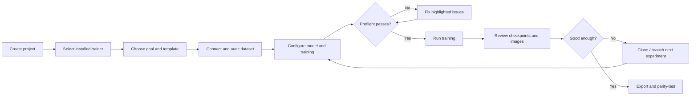
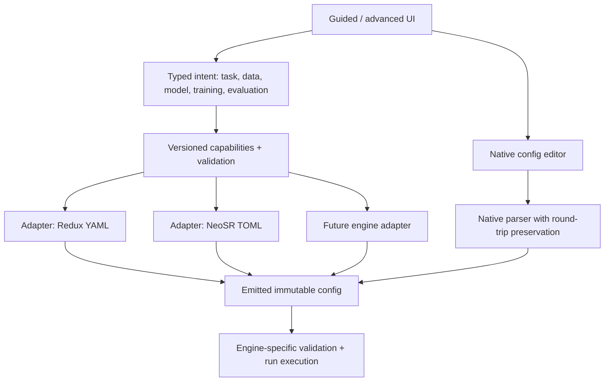
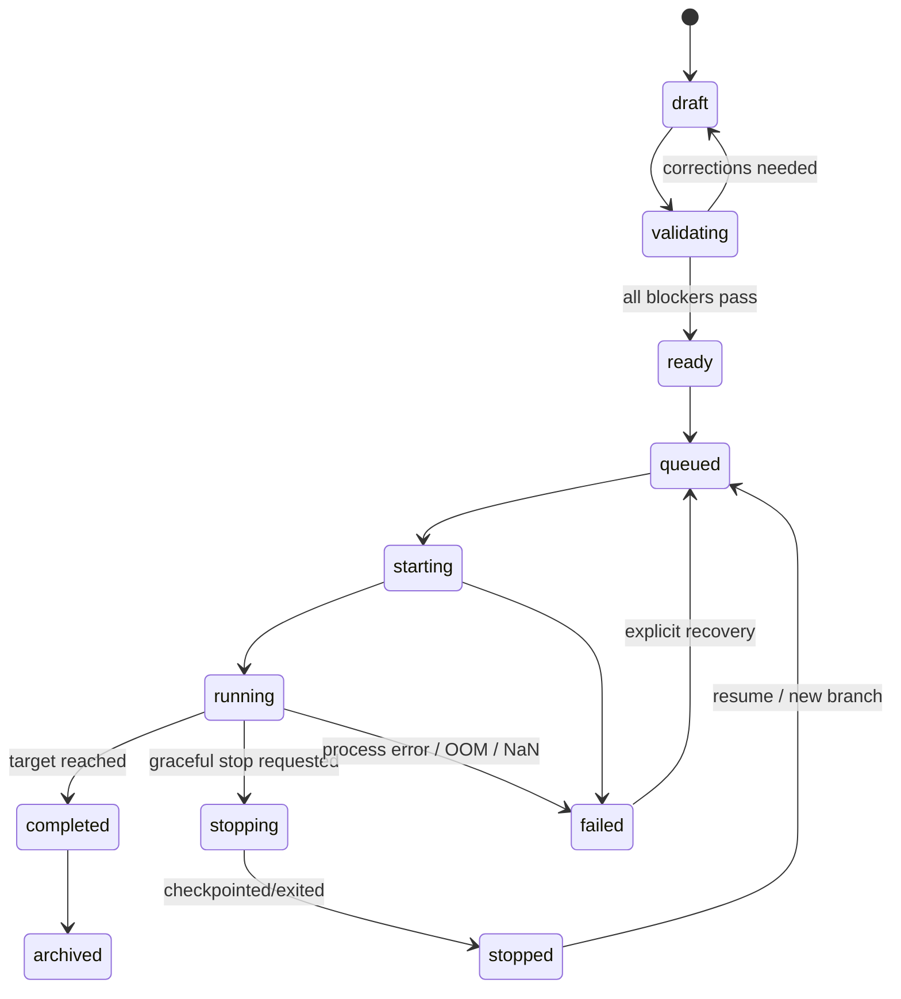
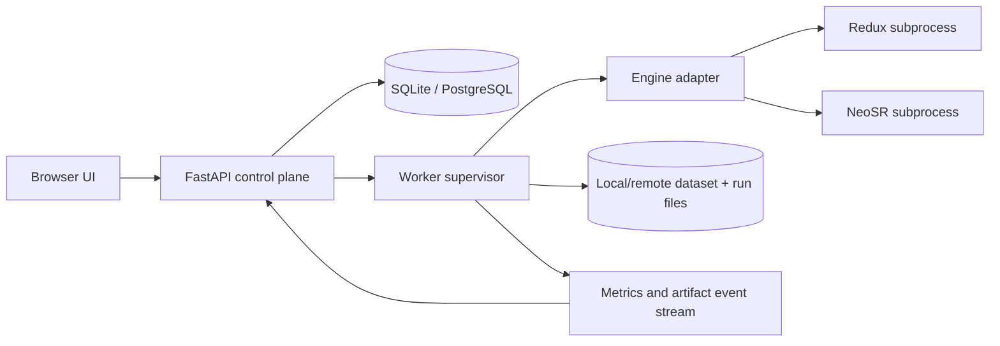

# SR Training Studio
## Product, UX and implementation proposal for a flexible web frontend for traiNNer-redux, NeoSR and similar SISR trainers

**Status:** Design proposal / implementation blueprint — not an implemented or tested product  
**Date:** 22 October 2026  
**Audience:** SISR researchers, model trainers, dataset curators, and frontend/backend developers  
**Working title:** **SR Training Studio** (placeholder, not a confirmed available project name)  
**Scope:** Primarily single-image super-resolution (×1 restoration, ×2 and ×4 upscaling); extensible to video and other restoration tasks.

> **Executive recommendation:** Build a **local-first, browser-operated experiment studio** with a Python backend and **version-aware trainer adapters**. The main experience is a guided workflow (Project → Data → Model → Training recipe → Preflight → Run → Evaluate), while an expert mode exposes complete YAML/TOML, launch arguments and unsupported settings. **Do not reimplement the training algorithms.** Invoke the original trainers and preserve their native artifacts, logs, and checkpoints.

---

## 1. Assumptions, goals and decisions

### Assumptions

| Item | Assumption / design choice |
|---|---|
| User environment | First release runs on a single Windows or Linux workstation, usually with an NVIDIA GPU; remote Linux worker follows. |
| Users | Two overlapping personas: a beginner who wants one successful run, and an expert who needs exact control and reproducibility. |
| Engines | First-class adapters for **traiNNer-redux** (typically YAML) and **NeoSR** (typically TOML); further engines can be added without rewriting the UI. |
| Priorities | Correct training setup, dataset quality, previews and diagnostics outweigh decorative AI assistance. |
| Data locations | Potentially very large datasets remain on the worker filesystem; no compulsory copying into a browser or web-server database. |
| Scope boundaries | The frontend is an **orchestrator and research workspace**, not a fork of the trainers, a universal config-translator, or a replacement for chaiNNer. |
| Version dependence | Available architectures, config keys, loss definitions, commands and supported devices depend on a **specific installed trainer version/commit**. |

### Product principles

1. **Progressive disclosure:** Simple mode presents high-impact controls; Advanced mode reveals implementation-specific settings; Expert mode enables raw config editing.
2. **No silent substitutions:** Never substitute an architecture, optimizer, pretrain, metric, loss or degradation when crossing engines.
3. **What-you-run-is-what-you-review:** Freeze and archive the exact emitted config, command, package/runtime fingerprint and dataset manifest for each run.
4. **Preflight before expensive compute:** Check data, devices, dimensions, model-pretrain compatibility and disk budget before launching.
5. **Images are first-class training data:** Visual validation, contact sheets, region-of-interest comparisons and artifact annotations are central, not hidden behind log charts.
6. **Safe changes:** Differentiate *resume full state*, *fine-tune from weights*, *branch experiment* and *restart from scratch*.
7. **Local-first, safe by default:** No open network service or arbitrary command execution by default; native filesystem permissions and explicit worker trust.
8. **Research flexibility:** Users can import any valid native config even when the UI does not yet understand every setting.

### Main recommendation and alternatives

| Approach | Recommendation | Why |
|---|---|---|
| **A. React/TypeScript web UI + FastAPI worker backend** | **Recommended** | Browser ergonomics, Python trainer ecosystem, reliable job orchestration, expandable to remote training and team workflows. |
| B. Desktop shell (Tauri) plus same backend | Strong later option | Native file dialogs, tray control and local deployment; adds packaging/platform maintenance. |
| C. Gradio/Streamlit wrapper | Prototype only | Fast to demonstrate, but becomes awkward for long-running jobs, schema-driven forms, comparison workflows and fine-grained state management. |

### What is *not* the ideal UI

A single 300-field YAML form is only a prettier config file. An overly rigid wizard that hides uncommon options will frustrate expert trainers. A generic visual node editor for all hyperparameters is attractive visually but cumbersome for the normal workflow. **Use conventional, comprehensible workflow pages with an optional node editor only for degradation pipelines and advanced curricula.**

---

## 2. Evidence from the supplied knowledge base

The source base consists of `chatlog-md-v1` Discord exports and locally supplied Redux/NeoSR documentation (`aio.md`). Discord messages are community observations, **not controlled benchmark results**; recommendations derived from them are labeled as design implications. No Discord attachment URLs are assumed to be live.

| Observed problem / insight | Product implication | Evidence |
|---|---|---|
| Users explicitly ask whether a modern SISR trainer has a GUI. | Guided installation, environment check and setup are legitimate needs, not optional polish. | discord #training 2025-03-20 19:15 user=Misaria |
| Users describe NeoSR and Redux as similar in purpose but different in config formatting and internals. | A **common UI intent model** with **separate adapters**, not a naive key-for-key converter. | discord #training 2025-03-20 19:22 user=Zarxrax; discord #training 2025-03-20 19:25 user=umzi |
| A GUI wrapping CLI tools and reading stdout to update progress was proposed years ago. | Launch native trainers as supervised subprocesses; parse their logs into structured events. | discord #coding 2019-04-13 11:49 user=Deorder; discord #coding 2019-04-13 11:54 user=Deorder |
| Paired LQ/GT workflows are highly sensitive to data generation, color shifts and loss configuration. | Dataset audit, degradation preview and input/output color QA before training. | discord #training 2022-11-07 19:13 user=Kim; discord #training 2022-11-07 19:47 user=bubblemint |
| OTF vs prepared paired degradations lead to different workflow choices. | Treat *Paired*, *Synthetic/OTF* and supported *Hybrid* datasets as explicitly distinct modes. | discord #training 2022-11-07 19:07 user=Kim; discord #training 2025-08-03 21:19 user=eula._; discord #training 2025-08-03 23:21 user=the database |
| Community members ask for multiple LQ sources corresponding to the same GT. | Dataset version/sample source-mixing should be an optional capability, gated by engine/version support. | discord #general 2024-05-21 10:40 user=Helaman; discord #general 2024-05-21 16:26 user=musl |
| Training must be evaluated with diverse images, including images outside the training set. | Add locked holdout sets, domain-specific probes and visual checkpoint comparisons. | discord #training 2024-03-07 22:25 user=Sirosky; discord #training 2024-03-07 22:35 user=the database |
| Users may stage training: pixel-only first, then perceptual and GAN. | A **curriculum / stage planner** with explicit checkpoint handoff, not uncontrolled live config editing. | discord #training 2024-03-07 21:13 user=musl; discord #training 2024-05-03 01:43 user=Helaman |
| Changing resolution, patch, batch and architecture changes training feasibility. | Normalize UI labels to **LQ patch pixels**, show resulting GT crop, effective batch and window constraints. | discord #training 2025-07-26 12:38 user=Helaman; discord #training 2024-07-30 10:15 user=Helaman |
| OOM, NaNs and loss-instability recur in real training. | Preflight memory probes, NaN policies and diagnosis panels with traceable causes. | discord #training 2019-03-06 18:42 user=Manakaiser; discord #training 2024-08-05 22:02 user=Brigadeiro |
| An overly short save/validation interval causes unwanted disk and performance overhead. | Checkpoint/validation scheduling with projected storage and runtime cost. | discord #training 2024-08-05 22:27 user=Helaman |
| Trainer/architecture version differences can affect exported-model inference. | Pin engine commit and offer *train-versus-export parity test* before publishing. | discord #training 2023-10-02 21:53 user=SlurmWorm; discord #training 2023-10-02 22:24 user=umzi |
| Color drift can reflect mismatched paired target colors. | Plot paired color statistics and test images for shifts; do not blame loss alone. | discord #general 2024-05-25 18:53 user=Zarxrax; discord #general 2024-05-25 18:54 user=Zarxrax |

**Documentation-derived baselines:** Redux exposes an architecture/loss registry, YAML configuration, `lq_size`, `batch_size_per_gpu`, `accum_iter`, optional pretrains, validation and logs. NeoSR exposes TOML configuration, a dataset `patch_size` in LQ pixels, `batch_size`, `accumulate`, a distinct OTF mode and `neosr-train config.toml`. Both conventions must be verified against the installed version rather than fixed forever. See [Redux documentation](https://trainner-redux.readthedocs.io/en/latest/) and [NeoSR repository](https://github.com/neosr-project/neosr).

---

## 3. Navigation architecture and information hierarchy

### Global shell

| Area | Content | Purpose |
|---|---|---|
| Top bar | Project selector · engine/version · current worker/GPU · global notifications · help | Always show **which trainer**, **where it runs**, and **what version**. |
| Left navigation | Overview · Datasets · Recipes · Experiments · Runs · Evaluation · Models · Workers · Settings | One place per user intent; no deep menu maze. |
| Context panel | Warnings · help · required dependencies · live config diff | Makes implications visible without leaving the current task. |
| Search/command menu | Jump to project, dataset, architecture, run, checkpoint; quick actions | Power-user productivity. |
| Footer/status | Backend connection · worker heartbeat · storage available · queued jobs | Operational confidence. |

### Page definitions

| Page | Primary view | Essential operations | Advanced operations |
|---|---|---|---|
| **Home / Projects** | Recent projects, active runs, ready-to-launch recipes | New project, resume project, check worker | Export/import project bundle |
| **Datasets** | File inventory, paired coverage, health score, degradation gallery | Add paths, pair-check, split, preview | Duplicate detection, source-group splitting, versioned transforms |
| **Recipe editor** | Goal, model, datasets, losses, optimizer, schedule and validation | Create from verified template; save | Detailed loss stack, all native settings, conditional sections |
| **Preflight** | Blockers/warnings with evidence | Test config, test data, GPU dry run, launch | Profiling/diagnostics and override log |
| **Runs** | Live throughput, VRAM, logs and sample outputs | Start, request graceful stop, resume | Multi-run compare, resource tuning, event analysis |
| **Evaluation** | Checkpoint gallery, side-by-side crops and metrics | Compare, annotate, select best | Blind ratings, domain subsets, export parity, benchmark report |
| **Models** | Checkpoints, stage ancestry, export targets | Load pretrain, export, tag release | Parameter-key compatibility, deployment benchmarking |
| **Workers** | Devices, installations, environment checks, queue | Add local worker, check health | Remote agents, GPUs, scheduling policies |

### Recommended core journey



**UX rule:** Users should be able to complete a valid default run through the guided path while seeing an **“Advanced / Show native config”** link on every step. The native config is never hidden or made disposable.

---

## 4. Primary UI wireframes

### 4.1 Main training workspace — desktop, 1440px target

```text
┌───────────────────────────────────────────────────────────────────────────────────────────────────────────────────┐
│ SR Training Studio    Project: Anime DVD Restore ▾      Engine: Redux @ 7d4…    Worker: Local RTX GPU ●      ⚙ │
├────────────────┬────────────────────────────────────────────────────────────────────────┬─────────────────────────┤
│ OVERVIEW       │  4× Anime DVD Restore  /  RUN #018               [Clone] [Stop safely] │ RUN INSPECTOR           │
│ DATASETS       │  RUNNING · stage 2/3: perceptual fine-tune                              │ Configuration locked    │
│ RECIPES        │                                                                        │                         │
│ EXPERIMENTS    │  Iteration          Throughput         GPU memory        ETA            │ Warnings (2)            │
│ RUNS      ●    │  78,400 / 150,000   3.8 it/s           14.2 / 24 GB     ~5h*          │ • loss ratio changed    │
│ EVALUATION     │                                                                        │ • val interval costly   │
│ MODELS         │  [ Losses ▼ ] [ Metrics ▼ ] [ LR ▼ ] [ VRAM ▼ ] [ Speed ▼ ]           │                         │
│ WORKERS        │  ┌───────────────────────────────────────────────────────────────────┐ │ Active setup            │
│ SETTINGS       │  │ time-series; choose separate or synchronized chart axes          │ │ 4× / SPAN / Paired     │
│                │  └───────────────────────────────────────────────────────────────────┘ │ LQ patch: 64 px         │
│                │                                                                        │ GT patch: 256 px        │
│                │  VALIDATION SAMPLES   [Text] [Line art] [Faces] [Compression]          │ Batch: 8 × accum 2      │
│                │  ┌────────────────────────┬────────────────────────┐                    │ Effective: 16           │
│                │  │ LQ / baseline          │ 78.4k checkpoint       │                    │                         │
│                │  │ fixed 200% zoom       │ zoom + pan linked     │                    │ [Native config]         │
│                │  └────────────────────────┴────────────────────────┘                    │ [Exact launch command]  │
│                │                                                                        │ [Open logs]             │
│                │  HISTORY  20k ◉ 40k ◉ 60k ◉ 78.4k ◉     [Compare checkpoints]         │ [Diagnose problem]      │
├────────────────┴────────────────────────────────────────────────────────────────────────┴─────────────────────────┤
│ ● Worker connected   • Job events saved   • Checkpoint retention: 3 kept + best pinned    *ETA is measured estimate │
└───────────────────────────────────────────────────────────────────────────────────────────────────────────────────┘
```

The numbers are **illustrative UI placeholders**, not measured benchmark claims.

### 4.2 Recipe editor — safe defaults and expert freedom

```text
┌───────────────────────────────────────────────────────────────────────────────────────────────────────────────────┐
│ Recipe / “4× Anime 2026 v3”                        [Beginner | Advanced | Expert]       [Save draft] [Preflight] │
├──────────────────────┬───────────────────────────────────────────────────────────┬────────────────────────┤
│ STEPS                │  3 / TRAINING STRATEGY                                    │ LIVE IMPACT            │
│ ✓ Goal               │  Training objective:   ◉ Fidelity  ○ Balanced ○ Texture  │                        │
│ ✓ Datasets           │                                                           │  LQ crop: 64 × 64      │
│ ✓ Architecture       │  Phase: pretrain (pixel) → fine-tune (pixel+perceptual)    │  GT crop: 256 × 256    │
│ ● Training strategy  │       → GAN finish [optional]                              │  Effective batch: 16   │
│ ○ Validation         │                                                           │  Pretrain: compatible  │
│ ○ Resources          │  Losses                  Weight    [Why?] [Plot contribution]│ VRAM: run probe needed  │
│ ○ Review             │  ☑ Charbonnier          [ 1.0 ]                           │                        │
│                      │  ☑ Perceptual           [ 0.1 ]    stage 2+               │  ⚠ Changing loss needs │
│                      │  ☐ GAN                  [ 0.0 ]    stage 3+               │  a new stage / run.    │
│                      │                                                           │                        │
│                      │  Optimizer [AdamW ▾]   LR [1e-4]   Schedule [Cosine ▾]    │  [View generated YAML] │
│                      │                                                           │  [Show config diff]     │
│                      │  [Learn how these settings interact]                     │                        │
└──────────────────────┴───────────────────────────────────────────────────────────┴────────────────────────┘
```

Numbers above are **illustrative inputs**, not universal defaults; real defaults come from version-pinned native templates and goal-specific curated recipes.

### 4.3 Dataset audit and preview

```text
 DATASET: DVD Repair v2          HR: 4,118 images   LQ: 4,111 images   Matched: 4,109 / 4,118
 [Scan again] [Fix pair mapping] [Create version] [Preview degradations]

 Diagnostics                           Sample viewer
 ├─ 9 HR files without LQ [BLOCK]      HR target  │ Paired LQ │ Regenerated LQ
 ├─ 2 orphan LQ files     [WARN]        synchronized zoom / checker / split overlay
 ├─ 6 resolution mismatches [BLOCK]
 ├─ 18 probable duplicates [REVIEW]    Color histogram / ΔE estimate / offset edges
 ├─ Color profile anomalies [WARN]     Transformation recipe + seed + source image
 └─ Suspected train/val overlap [BLOCK]

 Filters: [failed pairs] [low-entropy] [by source video] [by artifact class]
```

**Interaction priority:** A trainer should be able to visually inspect the exact sampled degradation **before** a 100k-iteration run. A static “looks like JPEG” label is insufficient.

---

## 5. A schema-driven UI rather than hard-coded forms

### Three layers: shared intent, engine configuration, exact artifact



**Key nuance:** A common *UI intent* is not a claim that all training operations are semantically identical. Preserve native settings as the source of truth for a run. Configs imported with unknown keys remain editable in Expert mode and are never silently discarded.

### Semantic field model

| Canonical concept | UI label | Redux example | NeoSR example | Conversion safety |
|---|---|---|---|---|
| Project/run identity | Run name | `name` | `name` | Usually direct; require unique output namespace |
| Upscale factor | Scale ×1/×2/×4 | `scale` | `scale` | Validate architecture-specific allowed scales |
| Generator | Architecture | `network_g.type` | `network_g.type` in TOML table | Option IDs and parameter schemas vary |
| Supervised dataset | Paired images | `datasets.train.dataroot_gt/lq` | `datasets.train.dataroot_gt/lq` | Verify matching/pair semantics |
| Input patch | **LQ patch (px)** | `datasets.train.lq_size` | `datasets.train.patch_size` | Match units first; old imported files may use different conventions |
| Micro-batch | Batch per GPU | `datasets.train.batch_size_per_gpu` | `datasets.train.batch_size` | Numeric meaning must be verified by adapter |
| Grad accumulation | Accumulation steps | `datasets.train.accum_iter` | `datasets.train.accumulate` | Derive effective batch, do not conflate with micro-batch |
| Weight initialization | Pretrained generator | `path.pretrain_network_g` | `path.pretrain_network_g` | State-dict/arch/scale/shape check; may need specific key |
| Losses and weights | Loss stack | `train`-level loss options, version-specific | `train`-level loss options, version-specific | **Do not automatically translate loss classes/weights** |
| Optimizer | Generator optimizer | `train.optim_g` | `train.optim_g` | Names/hyperparameters may differ |
| Validation | Samples/metrics | `datasets.val`, `val.*` | `datasets.val`, `val.*` | Paired vs single-image mode matters |
| Checkpoint interval | Save every N iters | `logger.save_checkpoint_freq` | `logger.save_checkpoint_freq` | Confirm trainer version; estimate storage |
| Resume | Resume previous run | `--auto_resume` supported | `--auto_resume` supported | Check complete state and run identity |
| Precision | FP32/FP16/BF16 | `use_amp`, `amp_bf16` | `use_amp`, `bfloat16` | Hardware and op compatibility required |

These are **representative** mappings from the supplied docs, **not a guaranteed schema for all releases**. The app should display the exact mapping and a `supported / partial / native-only / unsupported` marker.

### Adapter contract

Each installed adapter publishes a **capability manifest** for its *exact* version:

```yaml
adapter_id: redux                 # illustration of the product's manifest, NOT trainer YAML
runner:
  executable: /worker/venv/bin/python
  argv_template: ["train.py", "--auto_resume", "-opt", "{config_path}"]
fingerprint:
  repo_url: "https://github.com/the-database/traiNNer-redux"
  commit: "<resolved-at-runtime>"
capabilities:
  paired_dataset: true
  otf_dataset: version_checked
  hybrid_dataset: version_checked
  multisource_lq: version_checked
  multi_gpu: version_checked
  checkpoint_resume: true
fields:
  train.patch_lq:
    path: "datasets.train.lq_size"
    type: integer
    unit: lq_pixels
    min: 8
    constraints: ["architecture_window_divisibility", "dataset_minimum_crop"]
  train.batch_per_gpu:
    path: "datasets.train.batch_size_per_gpu"
    type: integer
  train.accum_steps:
    path: "datasets.train.accum_iter"
    type: integer
  artifacts.visualization:
    discover: "experiments/{name}/visualization"
```

The manifest schema is **proposed**, and the `version_checked` values deliberately mean *capability must be detected*, not "already supported". On adapter startup:

1. Resolve executable/interpreter, repo path, commit, package and CUDA/Torch versions.
2. Read native templates and registries where safely possible; augment with maintained version-specific overlays.
3. Compare manifest to known compatibility tests and show unsupported or unknown features as such.
4. Expose `GET /engines/{id}/capabilities` to populate forms dynamically.
5. Preserve extra unknown config nodes and comments (where possible) with `ruamel.yaml` or `tomlkit`.
6. Reject lossy round-trip exports unless the user explicitly accepts a visible diff.

**Important:** importing NeoSR TOML and exporting Redux YAML is **not** a transparent conversion. Differences in degradation distributions, loss implementations, scheduler behavior, checkpoint format and model loading can affect results. Offer an **assisted migration report** (“equivalent”, “approximately similar”, “no counterpart”) instead of a magical Convert button.

---

## 6. Dataset Workspace: the highest-value differentiator

### 6.1 Supported dataset modes

| Mode | UI workflow | Validation | Caveat |
|---|---|---|---|
| Paired LQ→GT | Select two folders / manifests; verify names and ×scale dimensions; preview pairs | Paired metrics + visual | Requires trustworthy spatial correspondence and photometric expectations |
| Synthetic offline | Import GT → build saved degradation recipe → materialize LQ and manifest | Fixed synthetic pairs | Requires storage, but reproducible and fast to inspect |
| On-the-fly | GT dataset → select engine-supported degradation components and ranges | Prefer **fixed-seed** synthetic set + real unpaired probes | Training changes degradation each sample; native support varies |
| Mixed paired + OTF | Only when engine advertises actual hybrid loader; choose weighted sampling semantics | Separate subsets for each degradation domain | Never pretend it is supported if it is not |
| Multiple LQ variants per GT | Attach named LR datasets and sampling weights | Tag samples with source/variant | Alignment and completeness must be checked per variant |
| Real unpaired probes | Input images representative of deployment domain | Visual-only/no full-reference PSNR | Distinguish “qualitative probe” from metrics dataset |

### 6.2 Dataset audit rules

| Check | Default policy | Severity / action |
|---|---|---|
| File readability, dimensions, bit depth, channels and color profile | Probe all headers; decode configurable sample; optional full decode | Invalid/unreadable → **block** |
| Basename pairing and pair count | Match via exact path/basename or configurable template; detect ambiguous matches | Missing/ambiguous → **block** for paired |
| Geometry | Check `GT_W = scale × LQ_W`, `GT_H = scale × LQ_H` (allow explicit alignment/crop plan) | Failure → **block** until addressed |
| Train/val/test separation | Hash exact duplicates; optional pHash/embedding similarity; group by original image/video/source | Leakage → **block/review**, never silently auto-resplit |
| Small/blank/repeated images | Show image distribution, entropy/variance and duplicates | **warn/review**, customizable filters |
| Color/gamma | Compare paired color spaces, white balance, dynamic range and channel means; inspect mismatches | **warn** with side-by-side examples |
| Blur/noise/compression distribution | Stratify representative gallery by degradation classes | **review** before training |
| Source leakage (adjacent video frames) | Group all frames from source clip/scene when splitting | **block** if overlapping between splits |
| Licensing/provenance | Optional source, rights, usage notes and checksum | **metadata warning**, configurable |
| Patch feasibility | Verify enough valid images support requested LQ crop and architecture constraints | **block** |

**Design distinction:** A “dataset health score” may summarize, but **never hide the underlying counts and the list of rejected files**. Export an audit report and a reproducible manifest. Default near-duplicate thresholds (pHash etc.) should be configurable and treated as candidate-review thresholds, not ground truth.

### 6.3 Degradation designer (the only node-style editor recommended early)

Create a **left-to-right image pipeline** with separate *training distribution* and *preview seed*:

`GT source → resize kernel/random scale → blur → noise → compression → color transform → LQ output`

Optional advanced components: second-order Real-ESRGAN degradation, camera/video codec simulation, interlacing cleanup before frame extraction, ringing/halo, dithering, chroma sampling, downsample/upsample, motion artifacts and per-source masks — **only** if a real plugin or backend stage supports them.

A node provides: `enabled`, probability, parameter distribution (fixed/uniform/log-uniform/weighted list), order, seed, clipping/color space and a **“Generate 12 examples”** action. For trained OTF, the UI must identify which operations are **actually native to the selected engine**; external preview-only transformations cannot be misrepresented as trainer behavior.

### 6.4 Patch and batch calculator

Always display:

```text
Upscale scale s = 4
LQ patch p = 64                  → HR patch = 256
Micro-batch per GPU b = 8
Gradient accumulation a = 2
GPU count g = 1                  → Effective batch = b × a × g = 16
```

For multi-GPU, validate actual distributed accumulation semantics for the adapter. Show an architecture constraint badge: e.g., “LQ patch must be divisible by transformer window size N,” with N taken from model metadata, not inferred from architecture family alone.

**VRAM caution:** A parameter-count estimate is not reliable for arbitrary transformer windows, discriminators, loss networks, OTF buffers and optimizer state. Use a conservative *heuristic range* before launch and a **short real allocation/forward-backward probe** where supported; label predicted VRAM and ETA as estimates and do not guarantee no OOM.

---

## 7. Recipe editor: configurable without becoming inscrutable

### 7.1 Intent-first controls

| User choice | Simple mode | Advanced and Expert |
|---|---|---|
| Goal | **Faithfulness** / **Balanced** / **Perceptual texture** / **Artifact removal** | Explicit metric priorities, losses, sampling and target domain |
| Domain | Photos, anime, manga, game textures, scans, compressed video frames, custom | Domain labels, stratified validation and weighted sampling |
| Scale | 1× / 2× / 4× (filtered by architecture) | Architecture-specific scales/heads and grayscale or alpha channels |
| Architecture | Recommended cards with training/inference cost class | All available architectures and architecture-native parameter form |
| Initialization | From scratch / compatible pretrained / fine-tune checkpoint | Partial loading, discriminator initialization, strict load, EMA weights |
| Optimization | Stability preset (clearly sourced) | Full optimizer(s), scheduler, warmup, G/D learning rates, clipping |
| Training style | Pixel-only / perceptual / staged with GAN | Arbitrary loss composition, phase transitions, discriminator selection |
| Validation | Fixed visual panel + optional paired metrics | Per-subset metrics, no-reference IQA, fixed seed, frequency, full-size image tiling |
| Resources | Auto GPU selection, safe dry run | Precision, `torch.compile`, CPU workers, accum, distributed and affinity |

**Warning against false precision:** Never present “sharpness = 75%” if it translates opaquely to six unrelated losses. Instead offer a named template and show **which exact weights and degradations it sets**. When adjusting a weight, show the resulting config diff, not just a label.

### 7.2 Architecture selection cards

Display each architecture with **verified capability badges**, not unproven global rankings:

- Supported scales, channels, patch/window constraints and compatible pretrains.
- Parameter count, measured *on this worker* training it/s, inference time and VRAM for **the selected LQ patch/batch**, where benchmarked.
- Default recipe provenance: official template, community recipe, user recipe.
- Known format/export constraints (chaiNNer/Spandrel/ONNX/TensorRT) tied to version and test status.
- “Experimental” vs “stable in this installation” refers to explicit test records, **not** a general claim.

**Proposed starter set (when installed adapter supports them):** SPAN/compact for fast iteration; RealPLKSR/MoSR or similar medium models for speed-quality exploration; DAT/HAT/transformer models for larger experiments. Do not assume every architecture appears in both trainers or that one is objectively superior across domains.

### 7.3 Loss composer

Each enabled loss is a row with name, weight, side (G/D), activation stage, normalized contribution plot and explanation. Offer image-centric presets, but never claim that absolute loss weights are comparable across loss families.

Useful diagnostics:
- A per-loss graph and raw scale; optional rolling median and **weighted contribution** (where formula can be reconstructed).
- G/D balance with logged discriminator outputs and event annotations.
- NaN/Inf detection and first occurrence iteration; optimizer/scheduler discontinuities.
- Clear **“loss values cannot be compared purely by magnitude”** explanatory text.

### 7.4 Training phases / curriculum editor

Represent stages as a timeline instead of promising live parameter mutation:

| Stage | Purpose | Typical configuration | Transition |
|---|---|---|---|
| Stage A — baseline | Learn distortion-faithful mapping | Pixel-oriented objective, easier degradations | Evaluate fixed holdout; save checkpoint |
| Stage B — perceptual | Restore texture while preserving structure | Pretrain from A; optionally add perceptual/color/frequency terms | Branch from selected checkpoint |
| Stage C — GAN finish | Add plausible high-frequency detail | Add discriminator/loss with conservative settings; frequent QA | Stop by visual QA and domain-specific goals |
| Stage D — polish (optional) | Stabilize final appearance | Lower LR / adjust patch or precision where justified | Keep best checkpoint, run export parity |

Do **not** hard-code training length (e.g., 30k) as a universal threshold. A legacy user may import a hand-tuned 500k recipe. Stages generate distinct run artifacts, with explicit handoff mode:

- **Resume full state:** load compatible model + optimizer + scheduler + counters and ensure config consistency.
- **Fine-tune from weights:** initialize a new run from chosen model weights, restart optimizer/scheduler as declared.
- **Fork/branch:** immutable snapshot of prior config, dataset version and checkpoint linked to a new experiment.
- **Continue without change:** use original immutable config to resume after interruption.

A phase transition needing a new optimizer or incompatible model head **cannot** be treated as a simple in-place resume.

---

## 8. Preflight: a built-in troubleshooting assistant, not an unsafe auto-fixer

### Preflight pipeline

| Step | Check | Blocks run when… | UI response |
|---|---|---|---|
| 1. Environment | Python, Torch, CUDA/ROCm, driver, trainer command and import test | Engine not usable on chosen device | Show exact stderr, interpreter path and documented install action |
| 2. Config syntax | Native YAML/TOML parse, required keys, unknown keys, type validation | Syntax/required constraint invalid | Highlight exact field and native path |
| 3. Architecture | Scale, channel count, window/padding and discriminator requirements | Known incompatibility | Show alternatives without changing automatically |
| 4. Dataset | Paths, samples, resolution correspondence and holdout isolation | Missing/invalid pairing; critical leakage | Open dataset audit filtered to failures |
| 5. Pretrain | Format, key names, tensor shapes and compatibility | Unsafe/incompatible load | Offer explicit strict/partial load only where supported |
| 6. Storage | Free space, dataset size, checkpoint size and retention policy | Critical space deficit | Suggest longer save interval/retention |
| 7. Resource probe | Short warm-up / single train-step in a sandboxed test job if supported | OOM, nonfinite loss or launch failure | Report observed peak/latency; offer ranked adjustments |
| 8. Reproducibility | Seed, config hash, dataset hash, implementation fingerprint | Never automatically block except user-imposed policy | Label deterministic vs best-effort |
| 9. Final summary | Warnings requiring acknowledgement | Only fatal issues | Preview exact command, effective config and output path |

### Diagnosis rules — examples

| Symptom | Diagnostics displayed | Suggested actions (user-approved) |
|---|---|---|
| CUDA OOM | Peak observed memory, GPU already used, patch, batch, AMP, discriminator/feature networks | Reduce **micro-batch** → accumulation; then patch/window; check workers and precision |
| NaN or Inf | First offending iteration, component, LR change, AMP scaler, divergence trends | Compare to last good checkpoint; reduce relevant LR, inspect loss graph, test different precision |
| GPU slow/underused | Data-loader wait versus compute time, samples/s and worker CPU/disk | Benchmark workers, storage/decoding, batch and architecture bottleneck |
| Color shift | Pair color audit, selected checkpoint comparisons, loss toggles and metadata | Inspect LQ/GT color consistency; isolate particular losses using a branched ablation |
| Grid/periodic artifacts | Output FFT/edge visualizer, architecture upsampler and input patch constraints | Compare checkpoints, tiling/padding and export runtime; do not assume it is always a GAN issue |
| Training and exported inference differ | Model hash, architecture settings, color and padding, inference precision | Run fixed tensor parity comparison in both backends and show numeric + visual differences |
| Endless saves | Mean checkpoint size and interval projected to total training | Keep most recent N + pinned best; enforce retention after atomic write and verification |

**Never auto-adjust LR or switch precision mid-run behind the user's back.** Auto-remediation may *propose a new recipe branch* with an inspectable diff.

---

## 9. Run control, telemetry and validation

### Run state machine



**Control semantics:**

| Action | Meaning | Required safeguards |
|---|---|---|
| Start | Launch immutable run configuration | GPU lock, output directory isolation, preflight pass |
| Request graceful stop | Ask trainer to exit cleanly | UI states whether last checkpoint was written; preserve log |
| Force terminate | Last resort after timeout | Explicit confirmation; possible checkpoint loss |
| Resume | Continue compatible training state | State/engine/arch/config fingerprint check |
| Clone/branch | Make new experiment using existing artifacts | Show inherited checkpoint and changed settings |
| Pause | **Only** if runner supports safe pause; otherwise expose graceful stop + resume | Never advertise instantaneous suspend as universally supported |
| Export checkpoint | Copy verified weights/metadata | Detect unsupported architectures/formats; parity test |

### Live dashboard

**Prioritize 5 signals above the fold:**

1. Current iteration, total target, stage name and status.
2. Smoothed iterations/second and ETA **with confidence window** based on measured run speed.
3. VRAM used/peak, GPU utilization and CPU/dataloader wait.
4. Last checkpoint time, validation time and warning/critical event count.
5. Latest fixed validation sample plus previous/best checkpoint switch.

**Telemetry design:** Parse native logs into common events (`RunStarted`, `StepMetrics`, `ValidationCompleted`, `ArtifactSaved`, `Warning`, `RunFinished`). Stream through SSE or WebSocket; preserve raw stdout/stderr with timestamps and sequence numbers. Reconnect clients via **last event id**. If parsing breaks after a trainer update, logs remain visible; show “metrics partially unavailable”, not a false zero.

### Image-led evaluation

| Tool | Interaction | Benefit |
|---|---|---|
| Linked zoom/pan | View LQ, GT (if paired), bicubic baseline, checkpoint output at same crop | Direct detail comparison |
| Vertical/wipe overlay | Flip, blend, difference and swipe | Detect halos, ringing, blur and color shifts |
| Contact sheets | Fixed probes for faces, typography, textures, foliage, flat colors, compression | Wider domain coverage |
| Checkpoint timeline | 1k / 5k / 25k … with selected image and notes | See non-monotonic quality |
| Domain metrics | PSNR↑, SSIM↑, LPIPS↓, DISTS↓ where supported | Contextual numbers, not a single “best” score |
| Unpaired quality | Side-by-side observations + optional no-reference IQA | Prevent invalid full-reference metrics |
| Annotated regions | Flag “color shift”, “checkerboard”, “plastic texture”, “line splitting” | Structured human QA |
| Blind A/B rating | Hide model identities until choice | Reduce confirmation bias |
| Reproducibility snapshot | Exact source image, crop, transformation, seed, model/checkpoint hash and inference options | Identical comparisons across runs |

**Metric discipline:** Only compare runs on the **same immutable evaluation subset**, color space, crop/shave settings, image reconstruction/tiling and metric implementation. PSNR/SSIM and perceptual IQA optimize different objectives; **never automatically declare one checkpoint the best** on a mixed metric score without a user-defined policy.

---

## 10. Project and experiment management

### Entities and storage

| Entity | Main fields | Retention strategy |
|---|---|---|
| `Project` | `id`, name, task/domain, target scale, owner, created | Long-lived |
| `DatasetVersion` | `id`, source roots, content manifest hash, transforms, seed, tags, split groups, audit | Immutable after use |
| `RecipeVersion` | `id`, engine fingerprint, canonical intent, native config text, schema revision, diff, parent | Immutable per saved version |
| `Experiment` | `id`, hypothesis, baseline run, variants, objective, validation protocol | Long-lived |
| `Run` | `id`, experiment, engine, worker, recipe/config hash, argv, status, timestamps, stage, return code | Immutable execution identity |
| `RunEvent` | run, sequence, wall/step time, event type, payload, raw line ref | Append-only |
| `MetricPoint` | run, step, split, metric, value, metric protocol hash | Append-only |
| `Artifact` | run, checkpoint/preview/log, path, size, checksum, format, iteration, parent | Configurable lifecycle |
| `Evaluation` | checkpoint, dataset version, metric protocol, human notes/ratings | Immutable result record |
| `Worker` | id, agent version, endpoint, devices, mounts, engine installations, heartbeat | Ephemeral status with historical metadata |

**Dataset reference:** Store *paths + manifests + hashes*, not all training images in SQLite. Use SQLite WAL locally for MVP; optionally PostgreSQL and S3-compatible object storage for multi-worker/team scale. Relate artifacts by **immutable identifiers**; checkpoint renaming does not break experiment lineage.

### Comparison table

| Run | Engine @ commit | Architecture | Data version | LQ crop | Effective batch | Objective | Evaluation outcome |
|---|---|---|---|---:|---:|---|---|
| A | Redux @ hash | SPAN | `anime-v2` | 64 | 16 | Pixel | metric snapshot / gallery |
| B | Redux @ hash | SPAN | `anime-v2` | 64 | 16 | Pixel + perceptual | side-by-side visual |
| C | NeoSR @ hash | SPAN | `anime-v2` | 64 | 16 | Closest native match | **not claimed identical** |

The table shows a **proposed experiment format**, not performed runs. All numerical comparisons must be measured.

### Smart experiment design

- “Clone and change exactly one factor” mode, with locked seed/data/validation protocol.
- “Parameter sweep” mode only after robust queue/device locking; resource budget mandatory.
- Explicit *controlled ablation* of degradation kernels or losses.
- Resume lineage graph: pretrain → fine-tune → checkpoint → export.
- Machine-readable report: hypotheses, variants, settings, results, screenshots, caveats.
- A *training journal*: “At 24k changed from loss profile A to B via new branch,” linked to artifacts, not edited into history.

---

## 11. Backend architecture and execution model

### Recommended stack

| Layer | Technology | Rationale |
|---|---|---|
| Frontend | React + TypeScript + Vite | Lightweight local-first app; mature tooling |
| UI | Tailwind CSS + accessible headless components (e.g., Radix/shadcn) | Dense data panels, keyboard operation, dark/light themes |
| Forms | React Hook Form + Zod or JSON Schema resolver | Dynamic conditional forms and validation |
| Config editor | Monaco Editor; YAML/TOML syntax services | Expert escape hatch with diagnostics and diff |
| Data query | TanStack Query, typed HTTP client | Server-state caching, reconnect handling |
| Charts | ECharts or uPlot for time series | Dense streaming plots without excessive redraw |
| Image QA | WebGL/canvas image viewer plus tiled assets | Linked zoom and large-image comparisons |
| API + worker | FastAPI + Pydantic | Natural Python access to trainer environments and file scanning |
| Job engine | Dedicated worker supervisor + durable queue | Jobs survive browser closure; subprocess lifecycle isolated |
| Persistence | SQLite WAL + Alembic (MVP); PostgreSQL optional | Reliable run/event history and migrations |
| Hardware | NVML / `nvidia-smi` integration; `psutil` | Resource inspection; clearly label unsupported platforms |
| Logs/events | Structured events + SSE; raw logs archived | Browser-independent training and reconnection |
| Config libraries | `ruamel.yaml`, `tomlkit`, `pydantic` | Round-trip config editing; typed adapter contracts |

**Important process boundary:** The **API service is not the training process**. Training runs in a managed subprocess with the installed trainer's interpreter and working directory. A worker agent owns GPU locks, stdout/stderr, process groups, timeout handling, and checkpoint discovery. Crashing a trainer must not crash the web API.

### Deployment modes



| Deployment | Features | First release? |
|---|---|---|
| Local embedded | `localhost` browser; worker and API on same machine | **Yes** |
| LAN trusted worker | Browser/control node connects to worker service with auth | Later |
| Remote SSH worker | Register a Linux worker, define mount aliases and GPU reservation | Later |
| Docker-based worker | Pinned container image, mounts, resource isolation | Later; never mandatory |
| Multi-user shared cluster | RBAC, quotas, audit, storage object store, Slurm | Future |

### Process execution safeguards

- Use `subprocess.Popen` or async process APIs **with argv list**, never `shell=True` with user input.
- Per-job generated config path under a uniquely named run directory; no clobbering existing experiment outputs.
- Separate executable/interpreter per trainer; no assumption of shared dependency compatibility.
- Worker path picker means *worker filesystem paths*, not browser-uploaded client paths.
- Restrict worker service by loopback/default auth; avoid arbitrary CLI execution and unsafe path traversal.
- Graceful stop sends the documented interruption signal; force-kill process group only after confirmation.
- Atomic writes/renames for application-owned metadata; verify checkpoint finalization before cleanup.
- Version-pin backend, adapters and trainer; reject mismatched remote agent protocol versions.
- Never load arbitrary `.pth` / pickle checkpoint data merely to inspect metadata on an untrusted service; use safe loading strategies and treat third-party checkpoints as untrusted executable content.

---

## 12. API and plugin interfaces — initial draft

### Suggested HTTP endpoints

| Method | Endpoint | Description |
|---|---|---|
| `GET` | `/api/v1/health` | Service, DB and worker status |
| `GET` | `/api/v1/engines` | Installed engines and resolved versions |
| `GET` | `/api/v1/engines/{engineId}/capabilities` | Versioned manifest |
| `POST` | `/api/v1/configs/import` | Parse/inspect native config; return AST, metadata, warnings |
| `POST` | `/api/v1/configs/validate` | Validate engine-specific emitted config |
| `POST` | `/api/v1/configs/emit` | Generate exact native config and diff |
| `POST` | `/api/v1/datasets/scan` | Start async dataset scan; returns job |
| `GET` | `/api/v1/datasets/{id}/report` | Pairing, geometry, leakage, source and color audit |
| `POST` | `/api/v1/degradations/preview` | Preview fixed-seed synthetic samples |
| `POST` | `/api/v1/recipes` | Save immutable recipe version |
| `POST` | `/api/v1/runs/preflight` | Return blocking issues, warnings and probe plan |
| `POST` | `/api/v1/runs` | Create and queue immutable run |
| `GET` | `/api/v1/runs/{id}` | Run status and live summary |
| `GET` | `/api/v1/runs/{id}/events` | SSE; supports replay using event ID |
| `POST` | `/api/v1/runs/{id}/stop` | Safe stop request |
| `POST` | `/api/v1/runs/{id}/branch` | New run from checkpoint with explicit state policy |
| `GET` | `/api/v1/runs/{id}/artifacts` | Checkpoints, visualization and logs |
| `POST` | `/api/v1/evaluations` | Run evaluation on frozen protocol |
| `POST` | `/api/v1/exports` | Engine-specific model export or report |

**API design note:** Run creation uses idempotency keys; use explicit state transitions and optimistic concurrency/revision IDs. Deletion means moving metadata to trash and applying checkpoint retention rules only with operator consent.

### Sample logical run payload

```json
{
  "project_id": "p-anime-dvd",
  "recipe_version_id": "rv-003",
  "dataset_version_id": "ds-2026-10-v2",
  "engine_installation_id": "redux-local-py313",
  "worker_id": "local-gpu-0",
  "start_mode": "new",
  "parent_checkpoint_id": null,
  "preflight_report_id": "pf-1004",
  "idempotency_key": "example-uuid"
}
```

The payload is a **proposed frontend/API contract**, not an existing Redux/NeoSR CLI schema.

### Minimum engine-adapter interface

```python
class TrainerAdapter(Protocol):
    def fingerprint(self) -> EngineFingerprint: ...
    def capabilities(self) -> CapabilityManifest: ...
    def parse_config(self, native_text: str) -> ParsedConfig: ...
    def validate_config(self, native_text: str, context: ValidationContext) -> list[Issue]: ...
    def emit_config(self, recipe: Recipe, imported_native: str | None) -> EmittedConfig: ...
    def command(self, config_path: Path, mode: LaunchMode) -> list[str]: ...
    def parse_event(self, line: str) -> TrainingEvent | None: ...
    def discover_artifacts(self, run: Run) -> list[ArtifactDescriptor]: ...
    def probe_compatibility(self, recipe: Recipe) -> list[Issue]: ...
```

Implement an **adapter test corpus**: native configs from pinned commits, round-trip tests, invalid values, representative log lines, checkpoint file discovery and a tiny smoke-train fixture. Do not depend on brittle stdout regexes alone when structured telemetry or TensorBoard events are available.

---

## 13. Detailed interaction and accessibility guidelines

| UI problem | Proposed behavior |
|---|---|
| 200+ possible controls | Searchable settings palette, expert drawers, per-field documentation, “show modified only” |
| Users forget parameter meaning | Inline tooltips with units, typical impact and links to **version-specific** docs |
| Loss weight unintelligibility | Display activation stage and observed contribution chart after run starts |
| Dangerous model changes | Diff + explanation + new run/branch action, no overwrite of active job config |
| Limited desktop space | Three-column layout collapses inspector; charts and sample viewer can be enlarged |
| Too many notifications | Severity-filtered warning tray; fatal failures remain sticky |
| Visual comparison bias | Toggle labels and blind comparisons; record annotation history |
| Color-critical comparison | Color-profile normalization explicitly shown; do not silently clip HDR/wide-gamut |
| Accessibility | Keyboard-first navigation, focus management, good contrast, reduced motion, screen-reader labels |
| International paths | Proper Unicode path handling and cross-platform normalization; test Windows drive letters and separators |
| Uncertain estimated metrics | Label `estimated` / `measured`, report measurement window and sample count |
| GPU conflicts | Queue with exclusive or policy-based device reservations; deny concurrent oversubscription by default |

**Avoid UI clutter:** keep a focused status summary visible, and put seldom-changed options under a structured advanced inspector. Parameter search should work even when its field is conditionally hidden, explaining why it is unavailable.

---

## 14. Implementation roadmap and priorities

A realistic plan prioritizes *working with actual trainers* over building every panel before the first launch. Dates below are **relative milestones, not delivery promises**.

| Phase | Build | Exit criteria | Priority |
|---|---|---|---|
| **0 — Discovery/fixtures** | Pin at least one Redux and NeoSR commit; collect native templates, actual train logs, state files and minimal demo datasets; verify OS constraints | Documented adapters and a tested compatibility matrix for a fixed release | P0 |
| **1 — Local run MVP** | Worker setup, one engine adapter, import/edit/save config, dataset path check, supervised subprocess, logs, safe stop, run status | Start and finish tiny real run, close/reopen browser without losing it | P0 |
| **2 — Dual engine + preflight** | Second adapter, versioned manifests, schema fields, emitted config diff, native editor, basic dataset audit, checkpoint resume | Both engines can run verified official tiny templates; import/export round-trip checked | P0 |
| **3 — Visual training studio** | Validation images, linked compare viewer, metric charts, checkpoint browser, run metadata | Compare two checkpoints at fixed images and record preference | P0 |
| **4 — Dataset & degradation** | Full scans, paired QA, source-safe splits, recipe generation and preview, OTF capability gating | Catch deliberate pairing/leakage/degradation errors before training | P1 |
| **5 — Research experiments** | Run branching, stage planner, ablation table, saved evaluation protocols, report export | Reproduce a comparison from recorded config/data/seed/engine IDs | P1 |
| **6 — Remote workers / packaging** | Auth, remote agent, mounts, quota/locking, Tauri optional | Remote job restart/reconnect and secure file access validated | P2 |
| **7 — Advanced tooling** | Sweeps, profiler, active-learning dataset triage, provenance graph, model export parity | Automated capability gated tests and approved reproducible report | P2 |

### Suggested MVP cut

**Must-have:** engine selection, import from existing native template, editable guided fields, native config view, dataset path/pair precheck, resource checks, start/stop/resume, live logs, CPU/GPU metrics, validation gallery, immutable runs.

**Should-have next:** degradation previews, dataset versioning, checkpoint comparison, branch experiment, multi-variant LR sources, dynamic manifest introspection, storage projection.

**Do not block the MVP on:** AI chatbot, public cloud deployment, multi-node distributed training, arbitrary custom neural networks, fully graphical degradation DSL or automatic loss optimization.

---

## 15. Suggested development package layout

```text
sr-training-studio/
├── apps/
│   └── web/                        # React/TS UI, routes, forms, viewer, charts
├── services/
│   └── api/                        # FastAPI app, auth, projects, datasets, runs
├── packages/
│   ├── contracts/                  # OpenAPI + JSON schemas, generated TS types
│   ├── engine-adapters/
│   │   ├── base/                   # Adapter protocol, fingerprint, capability schema
│   │   ├── redux/                  # YAML parser, templates, log event parser
│   │   └── neosr/                  # TOML parser, templates, log event parser
│   ├── runner/                     # Process supervisor, queue, GPU locks, signals
│   ├── dataset-audit/              # Manifests, pairing, decoding, leakage checks
│   ├── evaluation/                 # Metric protocols, image comparison artifacts
│   └── telemetry/                  # Raw logs, normalized event types, charts data
├── fixtures/
│   ├── redux/<pinned-version>/
│   ├── neosr/<pinned-version>/
│   └── tiny-datasets/
├── tests/
│   ├── contract/
│   ├── adapter/
│   ├── integration/
│   └── e2e/
└── docs/
    ├── adapters.md
    ├── security.md
    ├── recipes.md
    └── compatibility-matrix.md
```

### Test strategy

| Level | Verification |
|---|---|
| Unit | Config path mapping, types, unit conversions, effective batch formula, artifact tagging |
| Property-based | YAML/TOML round-trip (unknown keys/comments preserved where possible); no silent semantic coercion |
| Contract | Every field in a capability manifest points to an actual valid emitted native setting |
| Golden fixtures | Parse real Redux/NeoSR logs and error traces without truncating or inventing values |
| Dataset tests | Missing pairs, mismatched sizes, different bit depths, grayscale, alpha, duplicates, scene leakage |
| Worker integration | GPU lock, process crash, Ctrl+C/stop, reconnect, browser close, stale worker heartbeat |
| Real smoke tests | Tiny native template training on supported hardware; checkpoint, validation and resume successful |
| Visual QA | Alignment, zoom and image color consistency; large image tiling |
| Security | Path traversal, argument injection, untrusted `.pth`, remote auth, unsafe archive extraction |
| Reproducibility | Same frozen recipe + dataset + engine fingerprint produces identical input manifests and config hash; bit-identical model training **only when backend supports it** |

### Acceptance criteria for first usable release

- [ ] A new user can select an **installed** engine and produce a valid config using a verified official template.
- [ ] An existing user can import an unmodified native YAML or TOML, inspect it and save without losing unknown settings.
- [ ] Pairing and crop-size errors are reported with exact file names **before** the GPU run.
- [ ] The run continues when the browser tab closes; reopening reconstructs its status and log.
- [ ] A graceful stop and a compatible resume have been tested against **both** pinned engines.
- [ ] The run snapshot includes the exact native config, launch argv, engine commit, datasets, hardware and seed policy.
- [ ] Validation images are browsable and compared on fixed crops.
- [ ] A deliberately incompatible pretrain is rejected or explicitly reported as unsafe.
- [ ] A simulated log-format change cannot silently report fake telemetry.
- [ ] Native expert settings remain available even if the guided UI cannot represent them.

---

## 16. Stretch ideas with high research value

| Idea | What it would do | Priority / risk |
|---|---|---|
| **Loss contribution inspector** | Compare effective weighted loss magnitudes and transitions; flag pathological spikes without inventing optimal weights | P1 / must distinguish logged vs inferred values |
| **Data-domain coverage map** | Curate holdout slices for faces, vegetation, typography, line art, noise, gradients, compression | P1 / requires manual taxonomy or reviewed classifiers |
| **Active-learning dataset triage** | Surface worst-performing fixed probes and propose more representative training samples | P2 / guard against validation leakage |
| **Experiment narrative builder** | Generate report with hypotheses, config diffs, checkpoints, annotated sample grids and uncertainty | P1 / no unsupported causal claims |
| **Regression detector** | Compare latest checkpoint to pinned best visually and numerically for selected probes | P1 / warnings, not autonomous stopping |
| **Compatibility explorer** | Show pretrain ↔ architecture ↔ scale ↔ output-runtime compatibility as a matrix | P1 / per-version fixtures essential |
| **Model format integrity/parity** | Test native PyTorch vs exported format on a fixed image suite with numeric difference maps | P2 / backend-specific |
| **Measured throughput advisor** | A/B probe a few batch/patch/precision choices and rank based on measured *images/sec* and VRAM | P2 / avoid deleting user state |
| **Training cost planner** | Estimate wall time, electricity/remote GPU cost and disk using measured worker power and ETA | P2 / label estimates |
| **Artifact-aware attention / frequency view** | Inspect FFT/ringing/checkerboard color anomalies on validation outputs | P2 / analytical aids, not diagnoses |
| **Portable project bundle** | Export recipe, manifests, hashes, metrics and images without copying entire datasets | P1 / makes knowledge sharing easier |

**AI assistant positioning:** A future embedded assistant may explain a *known* setting, analyze a log, propose a small, testable ablation and link to a specific source. It must never silently change parameters or claim “optimal” settings from Discord anecdotes. Its suggestions should be reviewable changes to a cloned recipe.

---

## 17. Risks, tradeoffs and decisions to revisit

| Risk | Mitigation |
|---|---|
| Trainer updates break forms | Commit-pinned engine adapters; manifest CI against fixture versions; degraded-but-functional native editor |
| False equivalence of Redux and NeoSR | Semantic capability labels, versioned adapters and migration report with uncertainty |
| UI becomes too complicated | Progressive disclosure, task-scoped presets and user testing with beginner/expert participants |
| Metrics reward wrong perceptual qualities | Locked evaluation protocols plus visual and blind A/B comparison |
| Dataset audit takes hours | Fast header scan + sampled decode first, full scan as cancellable worker job |
| Runtime probes cause side effects | Dedicated test directory and isolation; explicit user confirmation for GPU work |
| Overenthusiastic auto-resume | Resume compatibility policy with exact run/engine/config fingerprint |
| Security of filesystem and checkpoints | Local auth, path allowlists, no shell execution, treat checkpoints as untrusted |
| Resource starvation | One GPU-intensive run per device by default; explicit queue policies |
| Very large images / HDD datasets | Thumbnail caching, virtual grids, paginated manifests, incremental hashing |

### Early product decisions (recommended)

| Decision | Pick |
|---|---|
| First supported OS | Windows + Linux where supported by installed trainer; avoid guaranteeing MPS/ROCm until tested |
| First model task | Paired ×4 SISR and ×1 artifact-removal; add OTF after adapter test coverage |
| Data schema | Typed UI intents + unchanged native config + manifest hashes |
| First UI layout | Three-pane desktop with collapsible right inspector |
| First workers | Local only, single-GPU reservation |
| First recipe | Import a real supported SPAN/compact template instead of hand-authored generic hyperparameters |
| Source of truth | Exact native generated config and execution snapshot, never just the frontend form |
| Validation norm | Fixed holdout + real-domain visual probes, both prominently visible |
| Auto-fix policy | Suggest + diff + explicit apply to **new version**, never mutate an active run |

---

## 18. Source inventory and reproducibility notes

### Local knowledge-base sources consulted

- `chatlog-md-v1_SR_GAN_Training_Assistant_instruction.md` — canonical parser and evidence/citation protocol.
- `aio.md` — supplied Redux feature matrix, guides, option descriptions and NeoSR config guidance; documentation is a snapshot, not a live installed registry.
- `training-01.md`–`training-07.md` — long-running community reports about pairing, losses, stability, evaluation, performance and training process.
- `neosr.md` — Discord `#general` trainer/developer exchange about architectures, degradations and experimentation.
- `coding-01.md`, `coding-02.md` — GUI/tool integration ideas and engineering examples.
- `discuss-01.md`, `discuss-02.md`, `image-01.md`, `image-02.md`, `umzi_vid_mdls.md`, `arches.md` — supplementary domain/architecture context.

**Parsing approach:** For `chatlog-md-v1` use frontmatter `schema/channel` and a message boundary beginning exactly with `### m:`, reading `ts=` and `user=` headers as authoritative; quoted replies are not counted as fresh independent recommendations. Evidence above cites **platform, channel, timestamp, user** as required by the canonical instructions. Community tips are not promoted into guaranteed benchmarks. Examples and wireframes are conceptual.

### Live primary references checked for current workflow orientation

1. [NeoSR — neosr-project/neosr](https://github.com/neosr-project/neosr): quick-start CLI (`neosr-train config.toml`) and current repository description.  
2. [traiNNer-redux — Getting Started](https://trainner-redux.readthedocs.io/en/latest/getting_started.html): YAML templates, launch/resume, checkpoint and validation paths.  
3. [traiNNer-redux — documentation index](https://trainner-redux.readthedocs.io/en/latest/): architecture, loss and option reference.  
4. [NeoSR — Configuration Walkthrough (archival mirror)](https://github-wiki-see.page/m/neosr-project/neosr/wiki/Configuration-Walkthrough): terminology and TOML keys, with explicit warning that a snapshot may be stale.

### Limitations

This proposal **did not execute Redux, NeoSR or train a model**. CLI commands and config keys are based on supplied documentation and official pages and need a live adapter compatibility suite before product release. All wireframe data, example settings and API shapes are design illustrations. Reported community speed/stability preferences are observations rather than validated cross-hardware benchmarks.

---

## Final product thesis

**The ideal SISR trainer UI is a reproducible experiment cockpit with excellent dataset and image-review tools, plus exact native configuration access — not a GUI that merely hides YAML and TOML.**

Start with **one reliable local run**, then add **safe multi-engine adapters**, **preflight validation**, **visual checkpoint evaluation** and finally **structured experimental design**. This is the shortest path to a system that is welcoming to new trainers *without weakening the control demanded by experienced SISR researchers*.
