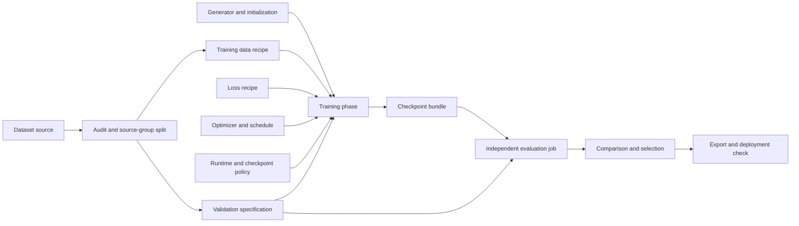
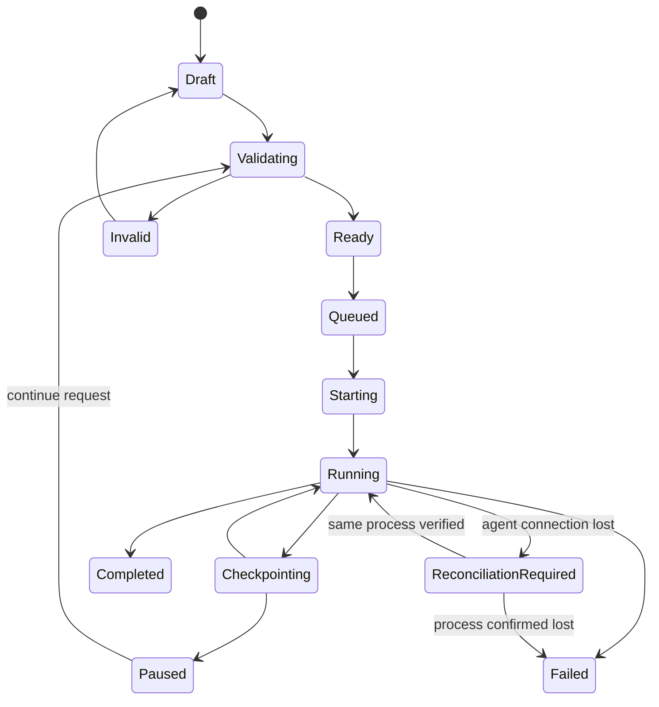
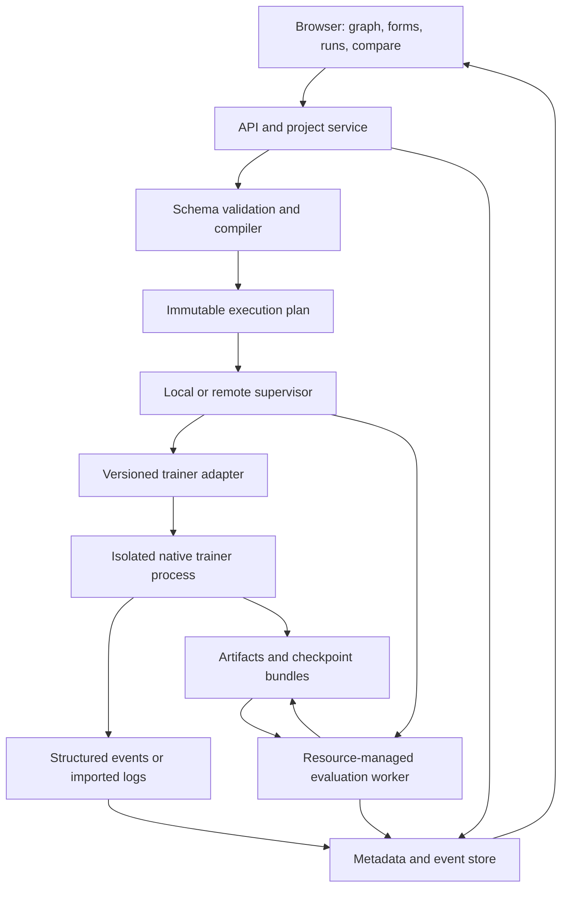

# SR Training Studio
## A node-based workbench for SISR training, evaluation, and reproducible experimentation

**Proposal version:** 0.1  
**Prepared:** 22 October 2026  
**Status:** Product and engineering proposal. No frontend was implemented and no training experiments were run for this document.  
**Primary targets:** traiNNer-redux and neosr, with a versioned adapter interface for other trainers.

> **Central recommendation:** Build a training workbench with a graph editor—not a graph editor with a training button. Use nodes to express data preparation, reusable training recipes, phases, and evaluation dependencies. Use structured inspectors for the many individual settings. Treat every launched run as an immutable, inspectable experiment.

## Contents
| Section | Focus |
|---|---|
| 1 | [Executive decision](#s01) |
| 2 | [What the training knowledge base says the interface must solve](#s02) |
| 3 | [Design principles and explicit non-goals](#s03) |
| 4 | [Information architecture and screen design](#s04) |
| 5 | [Graph model: recipes outside, training loops inside](#s05) |
| 6 | [Node catalog and complete configuration coverage](#s06) |
| 7 | [Data Lab: inspect the experiment before paying for it](#s07) |
| 8 | [Preflight and hardware-aware configuration](#s08) |
| 9 | [Integrated monitoring and evaluation](#s09) |
| 10 | [Resume, recovery, and experiment lineage](#s10) |
| 11 | [Explainable recommendations, not an opaque “auto” button](#s11) |
| 12 | [Engineering architecture](#s12) |
| 13 | [Configuration compiler and persistence](#s13) |
| 14 | [Installation, trust, and operational safety](#s14) |
| 15 | [Implementation plan: build the reliable path before the elaborate canvas](#s15) |
| 16 | [Testing and acceptance criteria](#s16) |
| 17 | [Distinctive features worth building](#s17) |
| 18 | [Worked user journey](#s18) |
| 19 | [Final recommendation](#s19) |
| Evidence | [Sources and methodology](#sources) |

## Assumptions and scope

| Assumption | Consequence |
|---|---|
| The initial audience is an individual model trainer or small research team. | Local-first installation, no mandatory cloud account, and no cluster infrastructure in the first release. |
| The first supported execution target is a tested, single-GPU Windows or Linux environment. | The browser can run elsewhere; actual hardware and operating-system support come from the selected backend adapter. Do not imply that a web frontend makes an unsupported trainer work on another accelerator. |
| Existing trainers remain responsible for forward/backward passes and optimization. | Compile workflows into native configurations and supervised jobs. Avoid replacing their training loops. |
| SISR includes scale-preserving restoration at ×1 as well as upscaling. | Support denoising, deblurring, and compression removal without forcing a resolution increase. |
| The user needs both straightforward training and unusual experiments. | A guided workflow and an expert graph must edit the same underlying specification. |
| “Optimal settings” depend on the task, data, architecture, hardware, and objective. | Offer explainable starting points, measured hardware recommendations, and bounded experiments—not a universal best-settings button. |
| The supplied knowledge base is historical evidence, not a live specification. | Discord exports extend into early January 2026. Current interfaces were selectively checked against official sources on 22 October 2026. Production adapters must pin and test exact revisions. |

**Evidence convention.** Footnotes marked **K** identify supplied Discord messages, with channel, timestamp, author, and local file location. Footnotes marked **R** identify official online documentation or source code. Historical observations motivate requirements; they are not automatically current bugs or universal training rules. All product behavior below is proposed unless explicitly identified as an existing backend capability.

---

<a id="s01"></a>
## 1. Executive decision

The best design is a **hybrid, three-view interface**:

| View | Primary question | Appropriate interaction |
|---|---|---|
| **Build** | What experiment am I defining? | A compact node graph with expandable groups and a searchable inspector. |
| **Run** | What is happening, and is the job healthy? | Persistent run dashboard, live diagnostics, checkpoint controls, and a frozen view of the executed graph. |
| **Compare** | Which checkpoint or experiment is better for my task? | Synchronized image inspection, protocol-aware metrics, run diffs, and explicit checkpoint selection. |

Add a **Guided mode** over Build for beginners and a **Native config** panel for expert users. These are alternative views of one specification, not separate configuration systems.

The canvas should usually show approximately **6–12 meaningful blocks**, not hundreds of scalar parameters. A learning rate is normally a field inside an optimizer inspector; a reusable optimizer recipe can be a node. A complete degradation pipeline deserves its own subgraph because its order and branching are meaningful.

The product should make this path natural:

```text
Choose or import a recipe
        ↓
Inspect data and actual training samples
        ↓
Validate compatibility and measure resource needs
        ↓
Launch an immutable run
        ↓
Inspect images, metrics, and training health together
        ↓
Continue, fork, fine-tune, compare, or export
```

### 1.1 Standalone workbench versus extending an existing node application

| Approach | Strength | Main limitation | Recommendation |
|---|---|---|---|
| **Dedicated browser workbench with trainer adapters** | Training lifecycle, state inspection, data governance, and evaluation are first-class concepts. | Requires a durable job supervisor and an adapter test suite. | **Preferred.** Best fit for the complete requested workflow. |
| **ComfyUI extension backed by a separate training service** | Familiar workflow interaction; potentially useful interoperability. | A long-running trainer still needs its own durable state, checkpoint, and recovery model. | Strong alternative when the intended audience already works primarily in ComfyUI. |
| **Schema-driven configuration application with an optional graph** | Fastest route to a reliable initial tool. | Complex data pipelines and multi-stage experiments are less visible. | Sensible first implementation layer, but not the final interaction model. |

ComfyUI already exposes workflow submission and progress interfaces; chaiNNer is explicitly oriented around composable image-processing workflows. Borrow their interaction principles without assuming that their execution models automatically solve training management.[^R8][^R9]

**Do not begin by forking their entire application.** First prove the trainer adapter, configuration fidelity, process supervision, and evaluation model. A polished canvas cannot compensate for unreliable execution.

---

<a id="s02"></a>
## 2. What the training knowledge base says the interface must solve

The most valuable lessons are about preventing expensive mistakes, not finding more switches.

| Evidence from the supplied logs | Interpretation | Product requirement |
|---|---|---|
| Helaman explains that validation graphs come from TensorBoard and require validation to be enabled.[^K01] | Users can miss useful monitoring because configuration and visualization are disconnected. | Validation setup, metric recording, and visualization belong in the same workflow. |
| Helaman describes confusion when patch-size semantics changed relative to scale.[^K02] | The same-looking number can imply a different input tensor. | Always display both LR and HR crop sizes, with units and backend-specific mappings. |
| musl explains that an optimizer learning rate was restored from the saved state in the discussed neosr version.[^K03] | Editing text is not proof that a resumed run will use that value. | Show **configured**, **restored**, and **effective runtime** values separately. |
| Helaman reports several unsuccessful precision/optimizer/architecture changes before regenerating LR data appeared to resolve the problem.[^K04] | A data-pipeline defect can masquerade as a training problem. | Data inspection and a reproducible “training sample viewer” must precede hyperparameter advice. |
| Helaman emphasizes validation on inputs representative of deployment, including unpaired examples.[^K05] | Synthetic-reference scores alone do not cover real-use behavior. | Separate paired validation, real-input galleries, and final test sets. |
| Hermes questions the usefulness of reporting iterations without batch and crop context.[^K06] | A single throughput number obscures the amount of work performed. | Show native iteration, optimizer updates, samples, and explicitly defined pixel throughput. |
| umzi documents changes needed to make Redux and neosr losses and processing more similar.[^K07] | Identical names and numeric weights do not establish equivalent training. | Preserve backend implementation identity; cross-backend conversion must disclose semantic differences. |
| A mixed paired/OTF dataset is described as choosing a source for a batch.[^K08] | “Mix datasets” is ambiguous unless the sampling unit is visible. | Distinguish per-image sampling, per-batch sampling, and paired-versus-OTF selection. |
| An apparent validation problem is later corrected: the wrong validation set was used.[^K09] | A diagnosis based only on an early message can be false. | Fingerprint evaluation data and retain corrections in the recommendation evidence store. |
| Helaman requests multiple LR sources with explicit random selection behavior.[^K10] | Data mixing is a genuine research workflow, not just a folder picker. | Provide a sampler editor with expected and observed source proportions. |
| A checkpoint-loading discussion warns that disabling strict loading may load little or nothing useful.[^K11] | “Fix incompatibility” is unsafe without inspecting matched tensors. | Show loaded parameter coverage and shape mismatches; never silently disable strict loading. |
| Precision debugging suggestions include comparing AMP, BF16, and FP32 behavior.[^K12] | Precision advice should be a testable hypothesis. | Offer controlled diagnostic branches rather than automatically changing an active run. |
| Helaman describes running additional metrics on saved checkpoint outputs.[^K13] | Evaluation is useful both during and after training. | A checkpoint can launch an independent evaluation job without restarting training. |

These are qualitative observations. They do **not** establish how frequently each problem occurs across all users.

### 2.1 A current example of why version-aware adapters matter

The reviewed Redux reference uses `lq_size` and explains its relationship to the older `gt_size`. The reviewed neosr walkthrough uses `patch_size` for the LR crop. Their batch and accumulation field names also differ.[^R1][^R2]

| UI concept | Redux mapping in the reviewed reference | neosr mapping in the reviewed reference |
|---|---|---|
| LR crop side | `datasets.train.lq_size` | `datasets.train.patch_size` |
| Images per device per microbatch | `datasets.train.batch_size_per_gpu` | `datasets.train.batch_size` |
| Accumulation factor | `datasets.train.accum_iter` | `datasets.train.accumulate` |
| Older HR-crop configuration | Convert only using the identified version’s semantics. | Do not assume an older template uses current semantics. |

The application’s label should be **“LR crop: 64 × 64 → HR crop: 256 × 256 at ×4”**, not simply **“Patch: 64.”**

---

<a id="s03"></a>
## 3. Design principles and explicit non-goals

| Principle | Practical rule |
|---|---|
| **Preserve capability without overwhelming the user.** | Common controls are curated; every supported backend option remains reachable through advanced or native inspection. |
| **Expose semantics, not just syntax.** | A crop has a coordinate space. A schedule has a clock. A mixture has a sampling unit. A checkpoint has a state inventory. |
| **Prefer visible constraints to failed launches.** | Invalid connections and unsupported combinations produce specific, actionable explanations. |
| **Make expensive actions explicit.** | Browsing, moving nodes, or editing a field must never launch training or a large evaluation. |
| **Keep authoring separate from execution.** | Editing a draft cannot alter an already-running experiment. |
| **Treat backend differences honestly.** | A feature can be native, externally orchestrated, hook-dependent, or unavailable. |
| **Make visual evaluation first-class.** | Charts and images should share checkpoint, sample, and protocol identity. |
| **Explain advice and preserve agency.** | Every suggested change shows its reason, evidence, uncertainty, and exact diff. |
| **Allow recovery without rewriting history.** | Continuations and forks retain provenance and never overwrite the parent run. |

**Non-goals for the first release:** a visual neural-network layer designer, a replacement for PyTorch, arbitrary Python execution inside the browser, automatic discovery of a globally optimal model, mandatory cloud storage, and a general-purpose distributed workflow platform.

The first release should be exceptionally good at one complete training-and-evaluation loop.

---

<a id="s04"></a>
## 4. Information architecture and screen design

### 4.1 Application shell

```text
┌──────────────────────────────────────────────────────────────────────────┐
│ Project: Photo restoration    Draft r17    Backend: Redux · pinned      │
│ Data | Build | Runs | Compare | Artifacts        [Check] [Launch…]       │
├───────────────┬─────────────────────────────────┬────────────────────────┤
│ Project tree  │                                 │ Selected: Train phase  │
│               │ Dataset → Audit → Train phase   │                        │
│ Recipes       │                    ↑   ↓         │ Essentials             │
│ Datasets      │             Model / Losses      │ Advanced               │
│ Workflows     │                    ↓             │ Native                 │
│ Runs          │                Evaluation       │                        │
│               │                                 │ Effective batch: 16    │
│ Node search   │ [Canvas] [Outline] [Native]       │ LR 64 → HR 256         │
├───────────────┴─────────────────────────────────┴────────────────────────┤
│ Problems: 1 blocker · 2 warnings | Samples | Changes | Resource probe   │
└──────────────────────────────────────────────────────────────────────────┘
```

The fixed top-level navigation should remain stable while the graph changes. A new user should not have to understand the graph to find validation results or resume a run.

### 4.2 Main screens

| Screen | What it should contain | Important interaction |
|---|---|---|
| **Project home** | Recent runs, active jobs, unresolved warnings, favorite recipes, available agents. | Resume the latest compatible run or start a named experiment. |
| **Data** | Dataset manifests, pairing audit, source groups, split assignments, filter reports, sample viewer. | Open a failing pair directly from a validation message. |
| **Build** | Canvas, ordered outline, inspector, native configuration, compiled-plan preview. | Editing in one view updates the same specification. |
| **Run** | Status, images, metrics, resource use, logs, effective configuration, checkpoints. | Select a metric point and open its associated checkpoint and examples. |
| **Compare** | Checkpoint contact sheets, synchronized image viewer, metric tables, protocol compatibility, config diffs. | Compare the same crop across runs without repeatedly navigating folders. |
| **Artifacts** | Checkpoint bundles, model exports, data recipes, reports, provenance. | Pin, evaluate, export, or branch from a verified artifact. |
| **Environment** | Backend installations, revisions, GPU information, dependency checks, adapter capabilities. | Revalidate an updated installation before using it in another run. |

### 4.3 Node anatomy

A node should show a short title, two to four important values, typed ports, a capability badge, and a status summary. The inspector contains the full form.

For a training phase, the compact card could show:

```text
GAN fine-tuning
Model: chosen architecture · ×4
LR crop 64 → HR 256
Microbatch 4 · Accumulate 4 · Effective batch 16
Initialization: checkpoint C018 · weights only
Status: 1 unresolved compatibility warning
```

Keep charts out of every node. A selected-node preview and the Run workspace are better places for dense information.

### 4.4 Beginner and expert interaction

**Guided mode** asks for task/scale, data availability, quality objective, execution environment, and intended deployment. It creates a complete template with visible defaults and a clear next step.

**Expert mode** adds subgraphs, phase transitions, advanced sampling, native options, and experiment matrices. Switching modes never discards settings.

**Search** should recognize both friendly names and native aliases: “crop,” `gt_size`, `lq_size`, and `patch_size` lead to the same conceptual control with the correct backend explanation.

**Accessibility** requires an ordered workflow outline, keyboard-operable forms and connections, readable focus states, and non-color status cues. React Flow provides accessibility hooks and keyboard interaction, but the application still needs its own complete, tested non-canvas path.[^R11]

### 4.5 Useful microcopy

| Situation | Better message |
|---|---|
| Invalid paired data | “17 LR images have no HR partner. Training is blocked. Review unmatched files.” |
| Unsupported OTF order | “This trainer cannot express this transform order natively. Materialize a paired dataset or choose a compatible extension.” |
| Resume conflict | “The checkpoint restores the optimizer learning rate. Your edited value will not take effect under this continuation policy.” |
| Missing training state | “These are model weights, not a resumable training bundle. Create a fine-tuning run.” |
| Different evaluation protocols | “These scores use different border crops. Re-evaluate both checkpoints before ranking them.” |
| Partial initialization | “72% of parameter elements matched. The remaining tensors will be initialized separately. Review before proceeding.” |

The last example is illustrative, not a measurement.

---

<a id="s05"></a>
## 5. Graph model: recipes outside, training loops inside

### 5.1 Separate three different graphs

| Graph | Meaning | Execution behavior |
|---|---|---|
| **Recipe graph** | Data sources, transforms, model definitions, losses, optimizer recipes, and validation policies. | Describes the experiment. Many nodes emit specifications, not immediate computation. |
| **Job graph** | Materialize data → train phase A → evaluate → approval → train phase B → export. | Executed by the supervisor as durable jobs. |
| **Run lineage graph** | Run A continued from checkpoint X; run B fine-tuned from X; run C changed degradation. | Records history. It is not a feedback wire that mutates prior jobs. |

The user can navigate these as related views. The implementation must not confuse them.

**A training phase is a stateful execution boundary.** Its internal iteration loop stays in the trainer. The browser must not send every batch through a chain of Python node calls.

### 5.2 Example workflow



The graph describes dependencies. It should not imply that native in-loop validation only happens after the final checkpoint; the phase’s validation policy governs those periodic evaluations.

### 5.3 Port types and semantic contracts

| Type | Required semantics |
|---|---|
| `DatasetRef` | Manifest identity, split, storage location binding, source grouping. |
| `PairedDataSpec` | Pairing rule, scale, channels, transforms, geometry policy. |
| `SyntheticDataSpec` | HR source, degradation implementation, randomness policy, output contract. |
| `ModelSpec` | Backend architecture identity, options, scale, channels, weights provenance. |
| `ObjectiveSpec` | Loss implementation, weights, reduction, target routing, discriminator requirements. |
| `OptimizationSpec` | Optimizer, parameter groups, schedule, update clock, accumulation semantics. |
| `ValidationSpec` | Data, inference policy, metrics, cadence, output retention. |
| `CheckpointRef` | Bundle identity and verified state inventory—not just a path string. |
| `MetricTable` | Protocol identity, sample identity, metric identity, direction, and measurements. |

Connections should be checked structurally and semantically. A paired-data port cannot accept an unpaired gallery simply because both ultimately contain images.

Use distinct labels or line styles for **specification inputs**, **artifact dependencies**, and **job-control dependencies**. Do not rely only on color.

### 5.4 Prevent “node spaghetti”

Allow collapsible groups, named reusable recipes, auto-layout, reroute points, bookmarks, semantic zoom, and breadcrumb navigation. Expose reusable parameters at a group boundary.

The rule for creating a separate node:

> Make it a node when users reasonably want to reuse it, preview it, branch it, independently execute it, or discuss its dependency on another component. Otherwise, make it a field.

A number constant can become a shared parameter for an experiment matrix, but ordinary users should not need to wire learning-rate constants into optimizer nodes.

### 5.5 What a connection does not promise

An arbitrary blur → resize → compression graph is **not automatically supported as native OTF training**. Compilation must prove that its ordering, distributions, and target routing match the trainer implementation.

When they do not match, offer a clearly labeled alternative: offline materialization, a tested extension, or a different backend. Offline materialization changes the sampling behavior and must create a new data-recipe identity.

---

<a id="s06"></a>
## 6. Node catalog and complete configuration coverage

### 6.1 Recommended node families

| Family / node | Main controls | Preview or validation | Priority |
|---|---|---|---|
| **Dataset source** | Local/agent location, format, manifest, provenance. | File inventory and readable sample grid. | Core |
| **Pair and audit** | Matching rules, scale, channels, geometry policy. | Missing pairs, dimensions, alignment warnings. | Core |
| **Group split** | Train/validation/test membership, seed, source grouping. | Leakage report and split manifest. | Core |
| **Preprocessing group** | Crop/patch extraction, decode, color conversion, filtering. | Before/after views with retained source lineage. | Later expansion |
| **Native degradation recipe** | Backend-supported OTF settings and probabilities. | Actual generated LR/HR samples. | Early expansion |
| **Custom degradation subgraph** | Ordered transforms, conditional branches, seeded distributions. | Per-stage image trace and backend-compatibility report. | Advanced |
| **Dataset mixture** | Source weights, sampling unit, replacement, balancing. | Expected versus observed composition. | Early expansion |
| **Generator** | Architecture, scale, channels, architecture-specific options. | Shape checks and resource probe. | Core |
| **Initialization** | Random start, weights, raw/EMA choice, strict loading. | Tensor-coverage and compatibility report. | Core |
| **Discriminator** | Architecture, options, input requirements. | GAN/objective compatibility. | Core for GAN |
| **Loss recipe** | Loss rows, target routes, weights, reduction, normalization. | Raw/weighted contribution traces where available. | Core |
| **Optimizer and schedule** | Separate G/D settings, clipping, warmup, schedule. | Planned learning-rate curve and resume impact. | Core |
| **Training phase** | All inputs, duration, phase-local behavior, transition policy. | Full effective-plan summary. | Core |
| **Runtime policy** | Agent, devices, precision, workers, seed, compilation. | Measured train/validation/checkpoint resource behavior. | Core |
| **Validation policy** | Datasets, metrics, cadence, inference policy. | Protocol card and estimated workload. | Core |
| **Checkpoint policy** | Save cadence, retention, integrity, stopping behavior. | Storage forecast and recovery guarantee. | Core |
| **Evaluation job** | Checkpoint selection, evaluation protocol, device budget. | Per-image and aggregate results. | Core |
| **Comparison / selection** | Candidate runs, slices, criteria, manual approval. | Images, metric differences, trade-off frontier. | Core |
| **Export / deployment check** | Format, target runtime, input contract, parity test. | Export verification and deployment previews. | Early expansion |
| **Experiment matrix** | Controlled parameter variations and compute budget. | Trial table with resolved settings. | Advanced |

“Core” does not require every family to appear as a separate top-level box. Several may be grouped inside a training-recipe macro.

### 6.2 Three levels of configuration access

| Level | Intended user | Behavior |
|---|---|---|
| **Essentials** | Most users | High-impact settings with units, explanations, and validated defaults. |
| **Advanced** | Experienced trainers | Full registered schemas, nested dictionaries, parameter groups, and backend-specific settings. |
| **Native** | Researchers and plugin authors | Original configuration structure with validation, diff preview, and clearly marked opaque extensions. |

There must be **no silent loss of configuration** when importing, saving, switching views, or updating a backend.

Full configuration coverage is a maintenance contract, not a promise that every future option has a handcrafted widget. Known schema fields receive generated controls. Unrecognized structures are preserved as native-only content until the adapter can validate them. Unsupported content must block execution rather than disappear.

### 6.3 Loss-composer behavior

Show losses as rows with implementation identifier, weight, target, color/range assumptions, and an optional schedule. Expand a row for layer weights and implementation-specific parameters.

Do not draw all losses as giant nodes by default. Provide a graph view only when target routing or branching is important.

Keep **raw loss**, **weighted loss**, and **gradient influence** distinct. Scalar contribution is not a measurement of gradient influence. A per-loss gradient diagnostic can be an explicitly requested, budgeted probe.

Generator and discriminator objectives need separate interpretation. Do not label a falling GAN loss as automatic image-quality improvement. The selection workspace should preserve multiple criteria rather than turn all metrics and losses into a single universal score.

### 6.4 Phase editor

Provide a horizontal phase strip above the canvas:

```text
Fidelity baseline → Human review → Perceptual/GAN branch → Optional final tuning
```

Each phase owns an explicit configuration and initialization policy. Changing objective, precision, crop, dataset mixture, or optimizer between phases should be possible, but never imply that the old optimizer state remains compatible.

A transition can mean **continue compatible state**, **initialize from weights**, or **apply a declared, tested state migration**. The application should not invent a new native trainer feature to implement a transition.


---

<a id="s07"></a>
## 7. Data Lab: inspect the experiment before paying for it

### 7.1 Dataset audit

| Check | Default response | Important qualification |
|---|---|---|
| Missing, unreadable, or corrupt images | Block affected training inputs and provide an exclusion/repair report. | Do not delete source files. |
| Duplicate pair identifiers | Block ambiguous pairing. | Case sensitivity, Unicode normalization, and subdirectory names can matter. |
| Incorrect scale relationship | Block unless a supported explicit geometry transform resolves it. | Correct dimensions alone do not prove alignment. |
| Suspicious spatial alignment | Show overlay, edge comparison, and flagged examples. | Treat automatic alignment scores as screening signals, not proof. |
| Channel, alpha, bit-depth, or color-space inconsistencies | Require an explicit conversion policy. | Intentional color restoration must not be “corrected” away. |
| Exact duplicates and likely near-duplicates | Show clusters and their split membership. | Near-duplicate thresholds require review; do not silently purge useful variants. |
| Related frames or crops crossing splits | Flag source-group leakage. | Group by originating image, scene, sequence, capture, or other task-relevant unit. |
| Very small or unusually large images | Explain crop feasibility and resource implications. | Padding, rejection, or resizing must be explicit. |
| Filters remove a large or uneven fraction of data | Show retention by source and content slice. | An IQA filter can change the training distribution. |
| Changed files since the last snapshot | Require a new dataset snapshot or a deliberate override. | A path and modification time are weaker evidence than a content digest. |

**Split original source groups before producing derivative crops or degradations.** All derivatives inherit their source’s split. For already-existing paired datasets, establish those groups from provenance where possible and mark uncertainty where it is not.

Use a fast inventory pass for initial feedback and an optional full content-hash verification for reproducibility. Display which verification level was completed. Do not label a partially scanned directory “fully verified.”

### 7.2 The “what the model sees” viewer

This should be one of the signature features.

The viewer displays a sampled training example after each relevant stage:

```text
Source HR → decode/color handling → geometric transforms
          → degradation stages → paired crop → final LR/target tensors
```

For paired training, show both members and their synchronized transforms. For OTF training, show the actual backend-generated LR, not an approximate JavaScript recreation.

Store the sample identity, source snapshot, transform parameters, crop coordinates, implementation revision, and relevant random-state information. A **Replay sample** action should either reproduce the captured transformation or explicitly say which stochastic stage cannot be replayed.

Use a separate RNG stream and scratch process for authoring previews. A preview must not consume the active training sampler’s randomness.

Offer pinned seed/example previews for controlled edits, plus multiple sampled realizations to reveal the distribution. One attractive degraded image is not evidence that the whole degradation recipe is appropriate.

### 7.3 Mixtures and stochastic transforms

The mixture editor should show:

| Field | Meaning |
|---|---|
| Sampling unit | Per example, per microbatch, or a trainer-specific unit. |
| Source weights | Relative sampling probabilities, not assumed dataset-size percentages. |
| Replacement and epoch behavior | Whether a sample can repeat and what “epoch” means. |
| Pairing policy | Whether LR variants share one HR source and how variants are selected. |
| Actual observed mix | A measured histogram from a probe or running job. |
| Backend realization | Native implementation, offline materialization, or extension. |

Keep a transform’s **apply probability** separate from its **parameter distribution**. For example, “apply blur to 30% of samples” is not the same as “draw a blur strength from a range including zero.”

Do not silently normalize malformed probability vectors. Offer a normalization diff and explain it.

### 7.4 Frozen evaluation and test data

Provide three distinct roles: paired validation for reference-based evaluation, an unpaired deployment gallery, and a protected final test set.

Repeated manual selection on a gallery makes that gallery part of model development. Do not keep calling it untouched test data. Disable automatic recommendation tuning on the final test set and record explicit test accesses.

---

<a id="s08"></a>
## 8. Preflight and hardware-aware configuration

The **Check** button should produce a structured report without launching the real experiment.

| Stage | Checks | Result |
|---|---|---|
| **Static** | Graph types, required fields, conflicting ownership, supported scales, paths, probability definitions. | Node-linked errors and warnings. |
| **Backend** | Parse with the selected native version; verify architecture/loss registration and capability rules. | Exact backend diagnostics, translated into useful UI language. |
| **Data** | Pairing, sample decoding, shape/channel contracts, split integrity. | Audited dataset snapshot. |
| **Initialization** | Checkpoint metadata, tensor names/shapes, selected weight variant, state compatibility. | Initialization or resume report. |
| **Runtime probe** | Data loading, representative forward/backward, optimizer step, selected losses, accumulation, validation, checkpoint write. | Measured resource and timing report. |
| **Launch review** | Final effective configuration, job plan, artifact locations, retention, outstanding risks. | User-approved immutable run specification. |

### 8.1 Resource probe

A resource probe must run in a disposable job using the real backend and candidate settings. It must not mutate the final run’s model, optimizer, dataset membership, or checkpoint history.

Include the first optimizer update, relevant generator/discriminator work, OTF machinery, and a validation example. Lazy optimizer allocation and validation can have different memory peaks from a simple forward pass.

Separate initialization/compilation warmup from steady-state measurements. Record measurement conditions: device, precision, architecture, crop, microbatch, accumulation, losses, data location, and implementation revision.

A **10–20% free-memory margin** can be an initial configurable heuristic, not a guarantee. Rare shapes, other GPU applications, and backend behavior can still cause failure. Validate representative worst cases where possible.

### 8.2 What can reasonably be recommended automatically?

| Setting | Defensible recommendation method | What not to claim |
|---|---|---|
| Microbatch | Measure candidate sizes with the actual objective and runtime. | “Largest batch always gives best quality.” |
| Crop size | Check architecture constraints and task needs, then measure feasible candidates. | “Larger crop always improves this dataset.” |
| Accumulation | Calculate a requested nominal effective batch and validate implementation behavior. | “Accumulation is identical to a larger physical batch in every network.” |
| Precision | Start with a version-qualified recipe, then test stability and memory. | “BF16 or FP16 is universally optimal.” |
| Worker count | Probe loading throughput and memory within a user-defined CPU budget. | “Set workers to the number of CPU threads.” |
| Learning rate | Start from a relevant tested recipe; propose a small controlled experiment. | Unconditionally scaling it from batch size. |
| Validation cadence | Balance measured validation cost, responsiveness, and recovery needs. | Treating validation as free. |
| Checkpoint cadence | Balance write cost, storage budget, and acceptable lost progress. | Promising recovery beyond the last complete checkpoint. |

For a conventional equal-sized distributed setup:

```text
Nominal effective batch = microbatch per device × accumulation × world size
```

Display this as a derived quantity. Record actual samples and successful updates separately when batches are partial, updates are skipped, or G/D schedules differ.

Gradient accumulation does not reduce the memory required by an individual sample’s forward/backward pass. Changing crop size also changes the training input distribution, so an OOM recovery must disclose that trade-off rather than silently shrinking crops.

---

<a id="s09"></a>
## 9. Integrated monitoring and evaluation

### 9.1 A run cockpit, not an embedded chart website

The main run page should answer: Is the job advancing? Are updates numerically healthy? Is the data representative? Are outputs improving for the intended use? Is a recoverable checkpoint available?

| Panel | Main content |
|---|---|
| **Progress** | Phase, native iteration, microsteps where available, successful G/D updates, samples seen, estimated remaining work. |
| **Learning** | Effective learning rates, individual losses, weighted losses, gradient diagnostics, skipped updates where instrumented. |
| **Quality** | Protocol-specific validation metrics and pinned output examples. |
| **System** | GPU memory, utilization, throughput, loading stalls, CPU/RAM, validation/checkpoint overhead. |
| **Recovery** | Last verified checkpoint, unsaved progress, stop policy, retention state. |
| **Events** | Warnings, phase changes, resume events, configuration differences, sample/protocol changes. |

Keep the native backend iteration counter intact. Add more useful clocks rather than redefining it.

Pixel throughput should specify **LR or HR pixels**, include batch/device aggregation, and state whether idle/validation time is included. Derive it from actual consumed sample shapes when available; otherwise mark it as an estimate.

### 9.2 Charts

Show raw values with an optional smoothing overlay, not a smoothed curve alone. Use explicit axis units and metric directions. Never connect points across a missing segment or protocol change as though they were one uninterrupted measurement.

A checkpoint line or phase boundary should appear across synchronized charts. Selecting it opens the corresponding images and configuration snapshot.

Store origin metadata for each series: backend hook, TensorBoard import, log parser, or independent evaluator. Unavailable gradient statistics should show **not instrumented**, not zero.

### 9.3 Metric protocol cards

IQA-PyTorch provides both reference-based and no-reference metrics; the LPIPS reference implementation also specifies its own input conventions. Therefore the UI must treat metric name, implementation, and preprocessing as one protocol, not as a bare label.[^R12][^R13]

| Metric / evidence | Display | Essential qualification |
|---|---|---|
| PSNR | Higher is better; dB. | Specify channel, range, border handling, alignment, and aggregation. |
| SSIM | Higher is better. | Specify implementation, channel treatment, window/settings, and preprocessing. |
| LPIPS | Lower perceptual distance is better. | Fix model/backbone, weights, input normalization, and implementation version. |
| DISTS | Lower distance is better for the chosen implementation. | Keep implementation and preprocessing fixed. |
| TOPIQ or other IQA models | Use registry-defined variant and score direction. | Full-reference and no-reference variants are different measurements. |
| No-reference IQA | Model-specific direction. | It is not direct evidence that reconstructed details match the missing ground truth. |
| Human review | Task-specific annotations or blind preference. | Record reviewers, examples, criteria, and whether viewing was blinded. |
| Latency / memory | Lower under a fixed workload is better. | Fix hardware, input size, precision, tiling, warmup, and timing methodology. |

Every evaluation protocol should include dataset snapshot, sample membership, decoder/color handling, metric implementation/weights, border crop, tensor range, clamping/quantization policy, inference precision, tile/overlap/padding, selected model-weight variant, and aggregation rule.

**Mean per-image PSNR and PSNR computed from globally pooled MSE are different aggregations.** The interface should identify the chosen one. Unknown historical protocols can be displayed, but should not automatically join verified ranking tables.

For reference-free galleries, disable reference-requiring metrics. Do not manufacture an HR reference from an unrelated image or treat a bicubic baseline as ground truth.

### 9.4 Checkpoint comparison lab

| Interaction | Benefit |
|---|---|
| Synchronized pan/zoom and cursor | Compare exactly the same location across checkpoints. |
| LR / SR / HR views | Understand the input and target rather than judging output in isolation. |
| Swipe and blink comparison | Reveal color shifts, edge changes, and local artifacts. |
| Fixed-scale difference map | Avoid misleading auto-rescaling of differences. |
| Checkpoint × image contact sheet | Find changes over training without opening folders. |
| Per-image metric table | Detect failures hidden by the mean. |
| Worst-case and content-slice views | Inspect text, foliage, line art, flat regions, compression, and other task-specific cases. |
| Bookmarked regions of interest | Track recurring failure areas across runs. |
| Blind A/B mode | Reduce preference based on model names or iteration numbers. |
| Manual champion selection | Preserve a deliberate choice even when it is not best on one metric. |

Browser display rendering is not the numerical evaluation pipeline. Compute metrics on the defined tensors server-side, and identify any 8-bit preview conversion, display interpolation, or color transformation.

Each metric point must link to a **specific checkpoint digest or explicitly identified transient validation state**. A validation image captured between saves must not pretend that an equivalent persisted checkpoint exists.

### 9.5 Avoid making monitoring a hidden bottleneck

Use a small, stable quick-look suite for frequent checks and a larger evaluation suite less frequently. Give these different protocol identities. Do not compare quick crops and full-image scores as one series.

Evaluation on another GPU can run independently from a committed checkpoint. On a single GPU, prefer a scheduled, supervised evaluation window or a queued evaluation after training releases the device. Do not launch a second model process into nearly full VRAM merely because the user opened Compare.

Retain native TensorBoard output for interoperability. Ingest it into the application where useful; an optional managed TensorBoard view can remain available for advanced inspection. The main experience should not require users to launch and correlate a separate tool.

---

<a id="s10"></a>
## 10. Resume, recovery, and experiment lineage

This is the highest-risk engineering area.

### 10.1 Separate four user actions

| Action | Initialization | State policy | Identity |
|---|---|---|---|
| **Continue** | Last chosen complete checkpoint from the same experiment. | Restore compatible training state; no undeclared scientific configuration changes. | New execution segment within the same run lineage. |
| **Fork from checkpoint** | Selected ancestor checkpoint. | Explicitly keep, reset, or migrate each supported state component. | New run with parent checkpoint and configuration diff. |
| **Fine-tune from weights** | Selected raw or EMA model weights. | New optimizer/schedule and declared warmup/start policy. | New run; not described as an exact continuation. |
| **Restart** | Declared initialization, possibly random. | Fresh training state and counters. | New run. |

A changed dataset, loss recipe, crop size, precision, optimizer, or implementation revision should normally create a fork. UI layout, labels, and annotations can change without redefining the scientific experiment.

### 10.2 What the backend actually saves

PyTorch’s checkpoint guidance distinguishes model weights from the additional state needed to resume training.[^R4]

In the reviewed source helpers, neosr saves epoch/iteration plus optimizer and scheduler state. Redux additionally handles AMP scaler state and an EMA counter when applicable. These helper inspections do not prove complete preservation of sampler, RNG, or every model-specific state component.[^R6][^R7]

Therefore use honest recovery badges:

| Badge | Required evidence |
|---|---|
| **Weights available** | Verified model artifact; no claim of training continuation. |
| **Training continuation available** | The adapter verifies the required model/state bundle for the intended continuation. |
| **Deterministic replay verified for this environment** | A pinned environment and interruption test demonstrate the stated replay guarantee. |

Do not label a normal `.state` file “exact resume” by default. PyTorch also cautions that full reproducibility is not guaranteed across releases, platforms, and configurations.[^R5]

### 10.3 Resume Inspector

Show a component-level inventory:

```text
Model weights:                 present / selected variant
Discriminator weights:         required / present / absent
Optimizer states:              present / compatible / incompatible
Scheduler state:               restore / reset / migration required
EMA weights and counters:      present / absent / not applicable
AMP scaler state:              present / absent / not applicable
Python / NumPy / Torch RNG:    verified / not captured / unknown
Per-device RNG:                verified / not captured / unknown
Sampler position and workers: verified / not captured / unknown
OTF queue or custom state:      verified / not captured / unknown
Data and environment identity: match / differ / unknown
```

The UI should explain which missing components prevent continuation and which prevent a stronger replay guarantee. Custom trainers may require more state.

Show the learning rate expected after restoration and the next scheduled change. A config field is not authoritative if loading optimizer or scheduler state supersedes it. Redux’s reviewed options distinguish restoring scheduler state from rebuilding it; this must remain an explicit adapter-specific choice.[^R3]

### 10.4 Safe stopping

**Pause and release GPU** should mean: finish a supported safe boundary, commit a resumable checkpoint bundle, acknowledge success, and stop the training process.

Do not implement it as an operating-system process suspension: that can retain GPU memory and does not provide a durable recovery point.

If a backend lacks a tested checkpoint-on-request hook, label the available operation honestly: **Stop; recover from checkpoint C018**. Display the estimated unsaved progress. Do not promise that sending an interrupt preserves the current step.

Checkpoint at an optimizer-update boundary where supported. Saving mid-accumulation requires preserving the accumulated gradients and associated counters; otherwise it is not the same state.

### 10.5 Checkpoint integrity and retention

A resumable artifact may consist of several files. Treat it as a bundle with a manifest, checksums, component roles, step identity, and a completion marker.

Publish completion only after a writer acknowledgement or a tested adapter-specific validation process. A file appearing in a directory, or merely remaining the same size briefly, is not sufficient proof of a complete bundle.

A managed writer should write temporary files and commit the manifest only after all components are durable. An unmodified backend may offer weaker guarantees; expose that limitation.

Retention must protect the latest recoverable bundle, user-pinned checkpoints, branch parents, and artifacts leased by active evaluations. Show estimated storage before a long run and never remove a required `.state` while leaving weights misleadingly labeled resumable.

### 10.6 Run lifecycle and reconnection



Browser disconnection, API restart, and worker failure are different events. Closing a browser tab must not stop training. A missing heartbeat must not immediately create another copy of the same job.

Use durable execution ownership and reconciliation before restarting. Multi-device jobs also require rank-coordinated stopping and state handling; support them only after adapter-specific tests.


---

<a id="s11"></a>
## 11. Explainable recommendations, not an opaque “auto” button

### 11.1 Recommendation hierarchy

| Tier | Example | Evidence standard | Application policy |
|---|---|---|---|
| **Hard constraint** | A crop violates an architecture requirement. | Version-specific validation or a reproducible backend test. | Block launch; explain the exact conflict. |
| **Supported default** | A template’s initial optimizer settings. | Pinned template and compatibility tests. | Populate a new draft and show provenance. |
| **Measured local advice** | A smaller microbatch leaves sufficient memory headroom. | Probe on the selected device and recipe. | Offer a reviewed configuration diff. |
| **Community heuristic** | Try a fidelity stage before a perceptual branch. | Contextual evidence with dates, authors, and limitations. | Suggest an experiment, not a guaranteed improvement. |
| **Experimental search** | Compare three candidate loss weights. | Predeclared objective, budget, seed policy, and evaluation protocol. | Require explicit launch approval. |

A suggestion card should contain the proposed change, triggering evidence, expected benefit, trade-offs, applicability conditions, confidence category, source, and **Apply to draft / Run diagnostic / Dismiss** actions.

Do not invent numerical confidence percentages. “Measured on this machine,” “tested template,” and “community observation” are more honest labels.

### 11.2 Example recommendation cards

| Trigger | Suggested response | Guardrail |
|---|---|---|
| Training fits, validation does not. | Test a supported validation tiling policy or a smaller evaluation workload. | Label the resulting inference protocol; do not silently change benchmark comparability. |
| Repeated non-finite gradients or skipped updates. | Preserve diagnostics and offer controlled precision/LR branches. | Do not assert a cause from one scalar or mutate the active run. |
| High data-loading time. | Profile decode/storage and test a bounded worker-count change. | Do not recommend unlimited workers or RAM caching. |
| Real deployment samples differ substantially from synthetic validation. | Add a separate representative gallery. | Do not claim a distribution-distance score proves real-world quality. |
| Changed schedule on continuation. | Display restored-versus-requested settings and propose a fork or supported restart policy. | Never imply that editing YAML/TOML overrides checkpoint state automatically. |
| Strong aggregate metric but obvious local artifacts. | Open worst cases and bookmarked regions; compare an earlier checkpoint. | Do not discard the run solely because one metric disagrees with visual review. |

### 11.3 Knowledge-base-backed assistance

Convert useful Discord evidence into curated rule records with task, backend/version applicability, architecture, data assumptions, observation, limitation, timestamp, author, and later corrections.

Deduplicate cross-posts before estimating support. A repeated message is not an independent experiment. Keep conflicting observations visible.

An optional language model can explain diagnostics, find relevant evidence, or propose a draft patch. It should not be the authority for compiler validity, checkpoint integrity, or launch permission. Retrieved logs and imported configurations are data, not executable instructions.

The assistant should be able to answer: **“Why is this value here?”** with the exact provenance chain: template → user edit → probe recommendation → approved change.

### 11.4 Bounded experiment design

Support small parameter matrices and one-factor comparisons first. Display the full trial table before launch and preserve a baseline.

Compare trials by the relevant budget: optimizer updates, samples, wall time, or measured compute—not an unlabeled iteration count. Use repeated seeds for conclusions that need them, and show variability when actually measured.

Do not treat early performance of different architectures or training phases as a reliable final ranking. Automatic pruning should be opt-in and restricted to experiments for which its bias is acceptable.

---

<a id="s12"></a>
## 12. Engineering architecture

### 12.1 Recommended stack

| Layer | Proposed choice | Reason and boundary |
|---|---|---|
| Browser application | React + TypeScript. | A typed component system for graph, inspector, tables, and image inspection. |
| Graph interaction | React Flow / `@xyflow/react`. | Custom ports and serializable graph layout are documented; training semantics still belong to the application.[^R10] |
| Forms | Curated controls generated from a shared schema, with native fallback. | Prevent frontend/backend drift while retaining good explanations. |
| API and domain models | FastAPI with typed application models and JSON Schema/OpenAPI contracts. | Suitable contract generation and validation facilities; native trainer parsing remains an additional check.[^R14] |
| Charts | Apache ECharts, initially. | Its dataset abstraction supports separating measurements from chart presentation.[^R15] |
| Image comparison | Dedicated canvas/WebGL-capable viewer as needed. | Pixel inspection, synchronized navigation, and explicit display transformations. |
| Job execution | A separate Python supervisor/agent process. | Long-running training must outlive an HTTP request or browser session. |
| Local metadata | SQLite on local storage, with controlled writers. | Keep the first deployment simple; do not share its database file over a network filesystem. |
| Artifacts | Managed filesystem directories plus manifests and digests. | Large checkpoints and images should not be blobs inside the metadata database. |
| Event transport | HTTP commands plus server-sent events with replay cursors. | Most live updates are one-way; add WebSockets only for features that need them. |
| Tests | Python domain/adapter tests and browser end-to-end tests. | Test experiment meaning and recovery before visual polish. |

Avoid adding Redis, Celery, Kubernetes, or collaborative editing solely because they are common in larger systems. Introduce distributed infrastructure when a demonstrated requirement warrants it.

### 12.2 Component boundaries



The supervisor must own process lifetime independently of the web server. Restarting the API should reconnect to an existing supervised job rather than kill or duplicate it.

Resource ownership belongs to the supervisor, not the canvas. Training, probing, preprocessing, and evaluation should declare their GPU/CPU/storage needs and queue accordingly.

### 12.3 Adapter contract

These are proposed interface responsibilities, not existing Redux or neosr APIs.

| Operation | Output / guarantee |
|---|---|
| `probe_environment` | Backend identity, revision, dependency fingerprint, devices, and health report. |
| `describe_capabilities` | Versioned schema plus support levels and conditional constraints. |
| `import_native` | Workflow representation, preserved native content, and import diagnostics. |
| `validate_native` | Native parser/build diagnostics without a full training launch. |
| `compile_workflow` | Native files, job plan, source map, resolved defaults, and compatibility report. |
| `launch` | Managed process descriptor, execution identity, and command receipt. |
| `normalize_event` | A typed event with its original source and clock semantics. |
| `inspect_checkpoint` | Component inventory, integrity, weight variants, and compatibility. |
| `plan_continuation` | Restored/reset/migrated state list and effective-value preview. |
| `request_checkpoint_stop` | Supported acknowledged safe stop, or an explicit unsupported result. |
| `evaluate` / `export` | Resource-managed jobs with protocol and artifact provenance. |

Keep adapters outside the frontend. A community backend should not require a separate UI rewrite.

### 12.4 Support levels

| Level | Meaning | Example |
|---|---|---|
| **Native** | Directly supported by this pinned backend. | A recognized optimizer or dataset configuration. |
| **Orchestrated** | Implemented as a surrounding job without altering the inner training loop. | Offline LR materialization or post-training evaluation. |
| **Instrumented** | Requires a small tested hook/shim inside the backend. | Checkpoint-on-request or actual post-augmentation tensor capture. |
| **Unavailable** | Not validated or cannot be represented safely. | An arbitrary unsupported OTF transform order. |

A plugin registry should expose these levels per feature and per revision. “Supports neosr” is too broad to be a useful compatibility statement.

### 12.5 Integration strategy

Begin with native configuration generation, supervised subprocesses, and ingestion of available logs/artifacts. Add structured hooks where they unlock concrete requirements.

Prefer a narrow callback protocol over copying whole trainer files into a permanent fork. Good hook points include resolved configuration, batch preview, completed optimizer update, validation result, checkpoint completion, and requested stop boundary.

Keep log parsing as a fallback. Preserve original lines, use version-specific parsers, and mark inferred fields. TensorBoard can carry useful scalar and image data, but it does not by itself define the application’s checkpoint lineage or run lifecycle.[^R16]

---

<a id="s13"></a>
## 13. Configuration compiler and persistence

### 13.1 One canonical specification, several views

The semantic workflow specification is the source of truth. Graph coordinates are presentation metadata. Moving a node must not change the experiment’s semantic hash.

Keep four related representations:

| Representation | Purpose |
|---|---|
| **Workflow revision** | Editable experiment definition, including backend-specific extension data. |
| **Canvas layout** | Node positions, groups, zoom, and bookmarks. |
| **Compiled native configuration** | The exact executable configuration for the selected backend. |
| **Resolved runtime snapshot** | What the trainer actually used after defaults, initialization, and state restoration. |

The native editor should use **transactional edits**: parse → show semantic diff → validate → commit to the workflow. Do not maintain two independently editable configurations and hope they stay synchronized.

### 13.2 Compilation pipeline

```text
Resolve referenced recipes and versions
→ bind datasets and execution environment
→ validate types, constraints, and parameter ownership
→ lower supported nodes into native backend semantics
→ preserve and validate backend-specific extensions
→ generate native configuration and node-to-field source map
→ invoke the native parser/build checks
→ freeze plan, defaults, dataset snapshots, and environment identity
```

Two nodes must not silently write competing values to the same native field. Report a conflict and identify both owners. Shared parameters need explicit binding.

The reviewed Redux source already contains annotated option structures and strict fields. Reuse that information through the adapter where appropriate, but do not assume every architecture or free-form nested option can be inferred perfectly from it.[^R3]

### 13.3 Import/export promises

| Promise | Required behavior |
|---|---|
| Semantic round trip | Importing and exporting a supported native config preserves its effective meaning. |
| Unknown-field preservation | Unrecognized data remains stored and visible; the native validator determines whether it can run. |
| Version migration | Produce a reviewable migration report, never a silent rewrite. |
| Comment handling | Preserve the original file; retain comments where the parser supports it. Do not promise byte-identical regeneration unnecessarily. |
| Plain-CLI portability | Export the exact native config and launch recipe, not just a proprietary graph file. |
| Backend switching | Report unsupported and semantically different options. Never promise identical training from a translated configuration. |

Store a source map from native fields and errors back to workflow node IDs and inspector controls. A native error should open the relevant UI field.

### 13.4 File formats

Use a single portable **`.srflow.json`** workflow file for authoring. Optionally package a project export as an archive containing manifests, native configs, reports, and selected artifacts.

Do not include large datasets or checkpoints by default. State whether an export is **recipe-only**, **reproducible references**, or **self-contained with selected artifacts**.

Suggested project layout:

```text
project/
  project.json
  workflows/
    restoration.srflow.json
  datasets/
    train.snapshot.json
    validation.snapshot.json
  protocols/
    paired-validation.json
  runs/
    run-id/
      workflow.snapshot.json
      execution-plan.json
      environment.lock.json
      native-config.yml-or-toml
      resolved-runtime.json
      compiler-report.json
      events/
      artifacts/
      checkpoints/
      evaluations/
```

Location bindings should translate logical dataset/artifact references into paths on each agent. Moving a project between machines should not require editing every node. Show both the logical reference and resolved path.

### 13.5 Core entities

| Entity | Essential fields |
|---|---|
| `Project` | ID, title, storage roots, policies. |
| `DatasetSnapshot` | Manifest digest, content-verification level, sample/group IDs, split membership, transforms. |
| `WorkflowRevision` | Schema version, backend constraints, nodes, edges, recipes, semantic digest. |
| `Run` | Workflow revision, resolved plan, objective, parent checkpoint, immutable identity. |
| `ExecutionSegment` | Run ID, attempt, agent, environment, restored state, start/end events. |
| `CheckpointBundle` | Component digests, clocks, weight variants, completion state, resume inventory. |
| `EvaluationProtocol` | Data, preprocessing, inference, metrics, aggregation, implementation versions. |
| `EvaluationRun` | Checkpoint digest, protocol digest, runtime environment, completion and failures. |
| `MetricSample` | Evaluation/run identity, sample or aggregate scope, metric, value/status, units, clock. |
| `Recommendation` | Preconditions, evidence, proposed diff, confidence category, decision. |
| `Annotation` | Sample/region/checkpoint references, reviewer, criteria, text. |
| `ArtifactLease` | Artifact, consuming job, retention protection and expiry policy. |

Represent missing, failed, and non-finite metric values explicitly. Do not silently turn them into zero.

### 13.6 Proposed API shape

| Endpoint family | Responsibility |
|---|---|
| `GET /v1/backends/{id}/capabilities` | Schemas and compatibility. |
| `POST /v1/workflows/{id}/validate` | Static/native validation report. |
| `POST /v1/workflows/{id}/compile` | Resolved immutable execution plan. |
| `POST /v1/probes` | Budgeted, disposable environment/resource checks. |
| `POST /v1/runs` | Launch request referencing a compiled-plan digest. |
| `POST /v1/runs/{id}/commands` | Stop/checkpoint/continue commands with idempotency keys. |
| `GET /v1/runs/{id}/events?after=cursor` | Reconnectable event stream. |
| `POST /v1/evaluations` | Evaluate a checkpoint using an explicit protocol. |
| `GET /v1/artifacts/{id}` | Authorized artifact/preview access. |

Use explicit schema versions, machine-readable error codes, optimistic revision checks, and durable command receipts. A repeated launch request must not create duplicate training processes.

Events should carry run/segment identity, sequence number, event type, wall time, native step and known clock mappings, origin, and typed payload. Keep image/checkpoint payloads out of the event stream; send authorized artifact references instead.

---

<a id="s14"></a>
## 14. Installation, trust, and operational safety

The friendly first-run experience should be: open the application, choose an existing trainer installation or create a pinned managed environment, verify hardware, register data roots, and run a tiny smoke test.

Do not require Docker for local use. A container may be useful for remote environments, but it is not the only packaging strategy. Keep the control service’s dependencies separate from each trainer’s environment.

| Risk | Required control |
|---|---|
| Imported workflow runs code unexpectedly | Import is inert. No execution, installation, shell command, or remote download without a deliberate action. |
| Unsafe shell interpolation | Build explicit argument arrays and validated environment variables; do not concatenate user text into shell commands. |
| Unsafe checkpoint deserialization | Prefer restricted loading where supported and inspect untrusted artifacts in a constrained worker. Restricted loading is not a complete security boundary. |
| Arbitrary plugin execution | Trusted plugin installation with visible permissions. A Python virtual environment is dependency isolation, not a security sandbox. |
| Local service exposed to hostile pages | Loopback by default, session authentication, origin validation, and appropriate CSRF protection. |
| File browsing leaks unrelated files | Allowed roots, canonical-path checks, symlink/traversal defenses, and authorization per artifact. |
| Remote agent misuse | Explicit enrollment, authenticated encrypted transport, scoped permissions, and audited commands. |
| Disk exhaustion | Forecasts, quotas, checkpoint reservations, and retention previews. |
| Imported archives or huge images | Bounded extraction/decoding, size limits, and safe temporary storage. |
| Support bundle reveals private data | Redact paths, secrets, and thumbnails by default; preview exactly what will be exported. |
| Backend update changes behavior | No in-place updates during a run. Pin revisions, rerun compatibility tests, and retain old environments as needed. |

Deployment artifacts should include recorded source/provenance and applicable license metadata without making automatic legal conclusions. Never upload datasets or run histories to an external service by default.

---

<a id="s15"></a>
## 15. Implementation plan: build the reliable path before the elaborate canvas

Use acceptance gates rather than a calendar-based promise.

| Milestone | Deliverable | Exit criterion |
|---|---|---|
| **M0 — Adapter and semantics spike** | Pinned Redux integration; minimal neosr translation/resume experiments; native-config import and validation. | Demonstrate crop, accumulation, initialization, schedule-restoration, and metric-protocol behavior. Record unsupported features. |
| **M1 — Complete local vertical slice** | One paired-training recipe, curated forms, a small graph, supervisor, checkpoints, logs, image previews, and native export. | Import → validate → launch → stop/recover → continue → inspect outputs, without manual folder editing. |
| **M2 — Evaluation and recovery product** | Comparison lab, protocol-aware metric tables, run lineage, checkpoint integrity, and retention. | Choose between checkpoints, rerun evaluation independently, and recover honestly after interruption. |
| **M3 — Broader recipes and backend support** | Fully tested neosr adapter, native OTF recipe previews, phase transitions, preserved advanced/native options. | Both engines pass their declared compatibility suites; unavailable features are visibly disabled. |
| **M4 — Measured assistance and flexible data graphs** | Resource probes, explainable recommendations, offline degradation subgraphs, dataset mixing, controlled trial matrices. | Every suggestion is traceable; every custom graph has an explicit execution realization. |
| **M5 — Remote and advanced research workflows** | Remote agents, approved plugins, richer automation, tested multi-device operation. | Fault-injection, security, and distributed-state tests pass for each supported environment. |

### 15.1 The first demo should be deliberately ordinary

Use a tiny paired dataset and a lightweight, supported architecture. Import a real native config. Show the LR/HR crop relationship. Launch training. Display one saved validation output. Stop using the advertised recovery policy. Continue from the verified bundle. Compare two checkpoints and export the native config.

This tests more of the product’s value than an impressive canvas with nonfunctional nodes.

### 15.2 Recommended repository boundaries

```text
apps/web/                  graph, inspector, run cockpit, comparison viewer
services/api/              projects, commands, schemas, authorized artifact access
packages/domain/           workflow, run, protocol, and checkpoint models
packages/compiler/         validation, lowering, source maps, migrations
adapters/redux/            version-qualified native integration
adapters/neosr/             version-qualified native integration
agents/local/              process ownership, resource queue, recovery
evaluation/                protocols, metric runners, image artifacts
tests/fixtures/            native configs, small images, states, expected reports
tests/integration/         actual backend and interruption tests
```

Keep the compiler and domain model testable without the browser. Keep the frontend able to use a deterministic simulated event source for development without claiming that simulated values are training measurements.

---

<a id="s16"></a>
## 16. Testing and acceptance criteria

### 16.1 Test the experiment’s meaning

| Test family | Representative cases |
|---|---|
| Configuration round trips | Known fields, unknown extensions, defaults, YAML/TOML import, comments retained separately, source-map correctness. |
| Compiler constraints | Wrong port type, contradictory field writers, invalid probabilities, unsupported OTF order, incompatible architecture options. |
| Native parity | Generated config parsed by the backend matches the intended effective settings; compare with an equivalent CLI run. |
| Data safety | Missing pairs, duplicate stems, scale mismatch, non-RGB inputs, corrupt images, source-group leakage. |
| Checkpoint compatibility | Weights-only versus full-state bundles, partial tensor loading, changed optimizer groups, raw/EMA choice. |
| Continuation semantics | Learning rate after restore, scheduler position, accumulation boundary, missing RNG/sampler state, backend revision changes. |
| Fault injection | Browser closes, API restarts, agent disconnects, trainer crashes, disk fills, checkpoint write is interrupted. |
| Metrics | Correct direction, preprocessing, aggregation, missing samples, protocol mismatch, identity/reference sanity checks. |
| Event handling | Duplicates, out-of-order delivery, reconnect cursors, resumed counters, incomplete imported logs. |
| Security | Path traversal, hostile workflow content, oversized inputs, plugin trust, unsafe deserialization. |
| Accessibility | Complete keyboard workflow through outline/forms, non-color statuses, focus recovery, screen-reader labels. |
| Performance | Large histories, many thumbnails, collapsed subgraphs, bounded telemetry overhead. |

Identity checks must respect the metric definition. For example, a perfect reference comparison can produce infinite PSNR; no-reference IQA should not be assumed to give a universal “perfect” score on an HR image.

A deterministic interruption test should compare uninterrupted and resumed execution under a specifically pinned setup. Where bitwise identity is not supported, report the narrower guarantee and the tolerance actually tested. Never hide a failed replay test behind a generic reproducibility badge.

### 16.2 Proposed product-quality targets

These are **acceptance targets, not achieved measurements**.

| Target | Acceptance interpretation |
|---|---|
| No silent semantic loss on supported native round trips | All supported fields and effective defaults preserved; unknowns remain visible. |
| No training interruption from browser closure | Job survives and is discoverable on reconnect. |
| No duplicate launch from request retry | Idempotent command handling is verified. |
| Every accepted “pause” has an explicit recovery point | Safe-save acknowledgement or clearly stated fallback checkpoint. |
| Every ranked metric has a protocol identity | Unknown protocols excluded from automatic rankings. |
| Responsive editing on a representative workstation | Target p95 input response below 100 ms for an agreed test graph; measure and publish conditions. |
| Low baseline monitoring overhead | Initial target below 2% wall-time overhead at the standard telemetry cadence, excluding requested validation/profiling; verify with repeated controlled runs. |
| Reliable artifact retention | Active evaluations, branch parents, and pinned recoverable bundles cannot be removed accidentally. |

### 16.3 Validate usability, not just implementation

Observe trainers completing four tasks: create a paired run, import an unfamiliar config, recover a stopped run, and choose a checkpoint using images plus metrics.

Measure task success, unnecessary manual edits, configuration mistakes, misunderstood resume behavior, and navigation effort. Compare guided mode and expert mode. The goal is fewer expensive mistakes—not simply fewer clicks.

---

<a id="s17"></a>
## 17. Distinctive features worth building

| Feature | Concrete behavior | Value / caution |
|---|---|---|
| **Training flight recorder** | Capture a bounded sample of actual data transformations and relevant update diagnostics. | Makes data problems inspectable. Must have strict storage and runtime limits. |
| **Checkpoint time machine** | Scrub checkpoints while keeping image, zoom, region, metric, and protocol fixed. | Directly connects training history to visible changes. |
| **What changes if I edit this?** | Preview affected nodes, data artifacts, resource estimates, and continuation compatibility. | Prevents a seemingly small edit from silently redefining the experiment. |
| **Failure atlas** | Save labeled regions such as halos, line breakup, color drift, or texture invention. | Converts subjective review into reusable regression cases; not an automatic diagnosis. |
| **Recipe provenance lens** | Click a value to see template, evidence, edits, and measured advice. | Makes defaults understandable and suggestions accountable. |
| **Deployment mirror** | Evaluate an export through the intended inference runtime and compare with training-side inference. | Detects loader, padding, tiling, precision, or weight-variant mismatches. Requires a real parity test. |
| **Budget-aware experiment sheet** | Present a few controlled trials with estimated cost, uncertainty, and stopping policy. | Encourages useful ablations instead of uncontrolled sweeps. |
| **Shareable experiment capsule** | Export workflow, native config, data/protocol manifests, environment identity, and selected results. | Supports reproducibility without automatically distributing private images. |
| **Training health explanation** | Separate “numerically unstable,” “data-starved,” and “quality not yet established,” with evidence. | Avoids one misleading green/red “model quality” indicator. |

The first three should be the product’s visual identity. They offer more practical differentiation than adding an unrestricted chat panel beside a generic canvas.

---

<a id="s18"></a>
## 18. Worked user journey

**Scenario:** A user wants a ×4 restoration model for compressed photographs and already has paired data.

| Step | User action | What the application does |
|---|---|---|
| 1 | Creates “Photo restoration ×4.” | Offers a version-qualified paired recipe and records the intended quality/deployment objective. |
| 2 | Registers HR/LR folders. | Builds a manifest, checks pairing and geometry, and opens representative examples. |
| 3 | Selects a supported model and optional weights. | Shows architecture constraints and tensor-loading coverage. |
| 4 | Sets LR crop to 64 and microbatch to 4. | Displays HR crop 256 at ×4 and the nominal effective batch. These are illustrative settings, not a recommendation. |
| 5 | Requests a resource probe. | Tests the actual objective, data path, and validation policy in a scratch job. |
| 6 | Reviews the suggested resource adjustment. | Shows the measured evidence, exact diff, and limitations. |
| 7 | Adds paired validation and real-input examples. | Creates separate protocol/gallery identities and checks for source overlap. |
| 8 | Launches. | Freezes the plan and starts an independently supervised native process. |
| 9 | Selects a validation point. | Opens corresponding images and the exact persisted checkpoint or transient-state label. |
| 10 | Notices a halo in one region. | Saves a failure-atlas bookmark and compares earlier checkpoints at that region. |
| 11 | Forks a lower-adversarial-weight experiment. | Shows which states will be retained/reset; never overwrites the original run. |
| 12 | Selects a checkpoint for release. | Runs the final declared evaluation, checks the export in the deployment runtime, and prepares a provenance report. |

A beginner can follow this path without understanding native option names. An expert can open the native config and inspect every emitted setting.

---

<a id="s19"></a>
## 19. Final recommendation

Prioritize these foundations in order: **configuration fidelity, trustworthy recovery, integrated visual evaluation, and data visibility**. Build richer graph composition and automated recommendations on top of them.

The optimal interface is not one where everything can be connected to everything else. It is one where users can express sophisticated experiments while seeing what those connections actually mean.

**Recommended product definition:**

> A local-first visual SISR training workbench that compiles reusable recipes into version-pinned native trainer jobs, records complete experiment provenance, and makes data, checkpoints, images, and metrics inspectable in one place.

The most important design boundary is simple: **the workflow is editable; the executed experiment is immutable.** The most important usability boundary is equally simple: **a model checkpoint, a training state, and a saved workflow are different artifacts.**

---

<a id="sources"></a>
## Sources and evidence notes

### How the knowledge base was used

This was a focused design review, not an exhaustive statistical analysis of the Discord archive. Retrieval prioritized configuration, resume behavior, data quality, monitoring, and evaluation messages from 2024–2025, followed by checks of relevant surrounding messages and corrections.

Message headers were interpreted using the supplied canonical `chatlog-md-v1` instructions. The concatenated exports in `neosr.md` were treated as separate channel sections so that a filename was not mistaken for a channel name. Internal identity used composite provenance rather than assuming short message IDs were globally unique. Public citations below omit those internal IDs.

Short acknowledgements, off-topic material, and duplicate cross-posts were not treated as independent evidence. Attachment URLs were not assumed to be fetchable, and attachment contents were not inferred. Timestamps are reproduced as exported; the advisory timezone offsets were not used to invent precise UTC conversions.

The supplied `aio.md` was useful as an index to trainer documentation and historical material. Current behavior cited in the proposal was checked against the official sources below rather than assuming that this aggregated document was a complete live specification.

**Limitations:** no trainer installation, GPU experiment, UI usability study, or backend integration test was executed. Online sources were reviewed as served on the access date; the moving branch URLs below are not a substitute for the immutable commits that a production implementation must record.

### Discord evidence

[^K01]: discord #training 2025-06-14 13:34 user=Helaman. Validation graphs and TensorBoard integration. Source: `training-06.md`, lines 53760–53762.

[^K02]: discord #general 2024-07-14 17:57 user=Helaman. Historical crop/scale terminology confusion. Source: `neosr.md`, lines 3852–3854.

[^K03]: discord #training 2024-07-16 21:04 user=musl. Historical restoration of optimizer learning rate from saved state; not asserted as an unchanged current bug. Source: `neosr.md`, lines 25713–25717.

[^K04]: discord #training 2025-05-23 11:41–11:43 user=Helaman. A reported LR-generation problem after several training-setting changes. Source: `training-06.md`, lines 51366–51377.

[^K05]: discord #training 2025-05-23 12:52–12:57 user=Helaman. Representative deployment inputs and unpaired visual validation. The document distinguishes reference-based from no-reference metrics. Source: `training-06.md`, lines 51378–51396.

[^K06]: discord #training 2025-11-11 06:12 user=Hermes. Proposal to improve training-work and throughput reporting; not a claim that the suggested counter change was adopted. Source: `training-07.md`, lines 13164–13172.

[^K07]: discord #training 2024-06-02 17:55 user=umzi. Historical work to align loss and processing implementations across trainers. Source: `neosr.md`, lines 20290–20298.

[^K08]: discord #training 2025-08-03 23:21 user=the database. Description of paired-versus-OTF selection at batch granularity in the discussed implementation. Source: `training-07.md`, lines 438–440.

[^K09]: discord #training 2025-02-24 21:55 user=the database. Correction of an apparent validation issue: the wrong validation set had been selected. Source: `training-06.md`, lines 29775–29779.

[^K10]: discord #general 2024-05-21 10:40 user=Helaman. Request for multiple LR sources and explicit sampling behavior. The exported message ends mid-thought; no missing conclusion is inferred. Source: `neosr.md`, lines 263–268.

[^K11]: discord #discussion 2024-06-05 00:53 user=sudo. Warning about unexamined non-strict checkpoint loading. Source: `discuss-02.md`, lines 23108–23110.

[^K12]: discord #training 2025-11-12 15:02–15:03 user=Helaman. Precision and numerical-stability diagnostic suggestions; treated as hypotheses, not proofs of causality. Source: `training-07.md`, lines 13193–13204.

[^K13]: discord #training 2025-01-08 08:55–08:57 user=Helaman. Post-training metric evaluation of checkpoint outputs. Source: `training-06.md`, lines 19124–19141.

### Official documentation and source code

For GitHub sources, `user=` identifies the publishing account or organization. For pages without an established individual attribution, it is explicitly `not-attributed`.

[^R1]: Read the Docs / traiNNer-redux 2026-10-22 (accessed) user=the-database. **Config file reference.** Crop-size naming and the selected dataset/runtime configuration concepts. The account names the repository owner, not a claimed individual author of every paragraph. `https://trainner-redux.readthedocs.io/en/latest/config_reference.html`

[^R2]: GitHub / neosr wiki 2026-10-22 (accessed) user=neosr-project. **Configuration Walkthrough.** LR crop, per-device batch, accumulation, and native configuration semantics. The page displays an edit date of 6 April 2025; access date is not publication date. `https://github.com/neosr-project/neosr/wiki/Configuration-Walkthrough`

[^R3]: GitHub / traiNNer-redux source 2026-10-22 (accessed) user=the-database. **traiNNer/utils/redux_options.py.** Annotated option structures, strict fields, and the scheduler-restart option. Exact behavior remains revision-dependent. `https://raw.githubusercontent.com/the-database/traiNNer-redux/master/traiNNer/utils/redux_options.py`

[^R4]: web / official PyTorch tutorials 2026-10-22 (accessed) user=not-attributed. **Saving and Loading Models.** Model state, optimizer state, inference mode, and general checkpoints. `https://docs.pytorch.org/tutorials/beginner/saving_loading_models.html`

[^R5]: web / official PyTorch documentation 2026-10-22 (accessed) user=not-attributed. **Reproducibility.** Reproducibility limitations and sources of randomness. The stable documentation redirected to this versioned page when reviewed. `https://docs.pytorch.org/docs/2.14/notes/randomness.html`

[^R6]: GitHub / neosr source 2026-10-22 (accessed) user=neosr-project. **neosr/models/base.py.** Inspected save_training_state and resume_training helpers. This is not a complete audit of every stateful component in the repository. `https://raw.githubusercontent.com/neosr-project/neosr/master/neosr/models/base.py`

[^R7]: GitHub / traiNNer-redux source 2026-10-22 (accessed) user=the-database. **traiNNer/models/base_model.py.** Inspected training-state save/restore handling, including conditional scaler and EMA-counter handling. `https://raw.githubusercontent.com/the-database/traiNNer-redux/master/traiNNer/models/base_model.py`

[^R8]: web / official ComfyUI documentation 2026-10-22 (accessed) user=not-attributed. **ComfyUI Server Routes.** Workflow submission, validation, queueing, and server interfaces. Used as an interaction/integration reference, not proof of training-state guarantees. `https://docs.comfy.org/development/comfyui-server/comms_routes`

[^R9]: GitHub / chaiNNer 2026-10-22 (accessed) user=chaiNNer-org. **Project README.** Node-based image-processing workflow orientation. `https://github.com/chaiNNer-org/chaiNNer`

[^R10]: web / official React Flow documentation 2026-10-22 (accessed) user=not-attributed. **ReactFlowJsonObject and Handles.** Serializable flow presentation and custom connection handles. The semantic training compiler remains proposed application code. `https://reactflow.dev/api-reference/types/react-flow-json-object` `https://reactflow.dev/learn/customization/handles`

[^R11]: web / official React Flow documentation 2026-10-22 (accessed) user=not-attributed. **Accessibility.** Keyboard and accessibility integration points. `https://reactflow.dev/learn/advanced-use/accessibility`

[^R12]: GitHub / IQA-PyTorch 2026-10-22 (accessed) user=chaofengc. **Project README.** Reference-based/no-reference metric families and metric metadata. Production evaluation must pin implementations and weights. `https://github.com/chaofengc/IQA-PyTorch`

[^R13]: GitHub / PerceptualSimilarity 2026-10-22 (accessed) user=richzhang. **LPIPS reference implementation.** LPIPS interpretation and input conventions. `https://github.com/richzhang/PerceptualSimilarity`

[^R14]: web / official FastAPI documentation 2026-10-22 (accessed) user=not-attributed. **Features.** OpenAPI/JSON Schema and typed API documentation capabilities. `https://fastapi.tiangolo.com/features/`

[^R15]: web / Apache ECharts handbook 2026-10-22 (accessed) user=not-attributed. **Dataset.** Separation of chart datasets from presentation configuration. `https://echarts.apache.org/handbook/en/concepts/dataset/`

[^R16]: web / official TensorBoard documentation 2026-10-22 (accessed) user=not-attributed. **TensorBoard overview.** Scalar, image, and other visualization capabilities. Integration into this workbench is proposed. `https://www.tensorflow.org/tensorboard`
